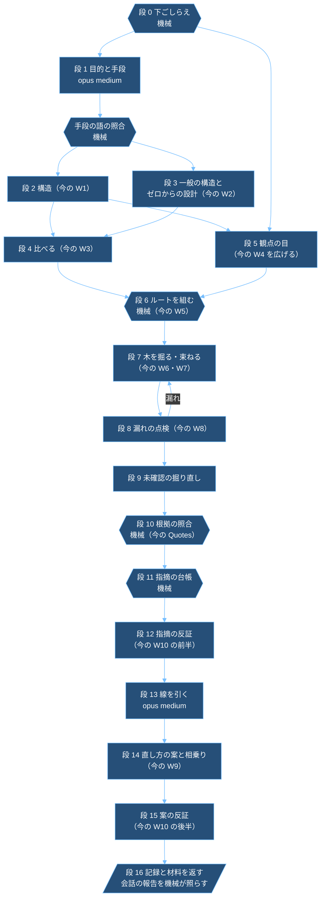

# /my-turn の掘る段の流れを作り直す設計（案）

- **状態**: 案（2026-11-18）。持ち主の承認まで実装しない。頼み d9f866。/my-turn は、持ち主のターンの PR をレビューするコマンド。その中の「掘る段」は、指摘を探して問いの木を掘り下げる部分。読み手は持ち主で、求めるのは、次のセクションの 6 点それぞれへの可否の返事（6 は再演を走らせてよいかの可否）。
- **今の形**: [今の設計書](my-turn-workflow-design.md)（承認済み・実装済み。以下「今の設計書」）。この文書は、今の設計書のどこを変えるかだけを書く。変えない所は今の設計書のとおり。
- **新しいファイルにした訳**: 今の設計書は、実装した形を書く文書で、1,700 行近くある。未承認の案をそこに混ぜると、どこが実装済みかが読み取りにくくなる（今の設計書のセクション 14 で既にそうなった）。承認されたら、この文書の中身を今の設計書のセクション 1〜13 に入れ、この文書は消す。

## 持ち主に決めてほしい点

1. **流れの形**: /my-turn（持ち主のターンの PR をレビューし、作者へのコメントの下書きを作るコマンド）の、問いの木（1 つの問いを子の問いに分けて掘り下げる形。ノード・葉などの語は後ろのセクション「語」）を掘る段の並びを、セクション 3 の 17 段に替えてよいか。替える所は 4 つ。
   - 掘って見つけた指摘を、機械が作る一覧（指摘の台帳）に全部載せ、報告まで運ぶ。今は会話が報告を書くときに黙って落とせる。
   - 問いを、PR が選んだ作りと PR が書いた理由の外から立てる。今は PR の作りを前提にした問いしか立たないことがある。
   - 指摘と直し方の案を、別々に反証する。今は案が崩れると指摘ごと消える。
   - 何を見るか（観点）を、段ごとに script が決めて渡す。
2. **観点の文の取り込み方**: works-factory（持ち主の別のリポジトリ）の `perspectives/` に在る、レビューで何を見るかを書いた文 67 本を使う。取り込み方は案 A を推す。
   - 案 A: 使う 19 本を、commit を決めて attention に写し、写した元を台帳に残す。script が段ごとに選んでエージェントへの指示に埋める。
   - 案 B: プラグインとして入れ、エージェントにスキルの名前で読ませる。読むかをエージェントが決めるので、読まない道が残る。比べはセクション 4。
3. **今の設計書で承認した決めを 2 つ変える**（セクション 5。ほかに承認の点 5・6・8・10 の中身が変わる所も、セクション 5 に並べた）:
   - 承認の点 11（今の設計書のセクション 12 の、承認のときに決めた 16 点の 11 番目）「行数などの数は機械で数えない」をやめ、足した行を実装・試験・検査などに分けて機械で数える。試験の行が実装の何倍か・目的に要らない変更が何行かを、指摘の材料にするため。
   - 差分を見ずに一般の作りを描くエージェント（今の W2）に、今渡す「PR の種類の 1 文」に加えて「PR の目的の 1 文」も渡す。目的から作るとどうなるかを描かせるため。承認の点に番号は無く、今の設計書のセクション 3 の W2 で決めた形。
4. **作者への下書きの絞り方**: 指摘ごとに、新しい段 13 が「この PR の設計で決めることか、部品の仕様どおりにすれば済む細部か、好みか」を決める。下書きにするのは設計で決めることだけで、細部はまとめて持ち主への報告に載せる。#2555 では下書きが 12 件で多すぎた（セクション 3 の段 13）。
5. **今の設計書の 14.6 の未決の 5 点**（エージェント数の上限・深さの上限・漏れの点検を 1 回にする・言い替えを束ねるのをコードにする・反証を場所でまとめる）は、どれも今回は採らずに閉じる。見落とし約 35 件のうち、上限で落ちた物は 0 件だったため（セクション 6）。0 件は今の流れでの数で、新しい流れは問いが増えて上限に当たる回が増えうるので、再演で上限で掘らなかった数を見る。
6. **効き目の測り方と費用**: 実装の前に、見落とした約 35 件の一覧を作る。直した流れで 4 件の PR を、前に走らせたのと同じ commit で走らせ直し（以下「再演」）、何件拾えたかを数える。4 件の全部の再演は合わせて約 290〜380 USD、前の記録の写しと途中の測りを足した全部で約 370〜540 USD の見込み（セクション 7）。走らせる前に司令塔（持ち主への中継と頼みの振り分けをする部署）に額を添えて問う。

## この文書の要点

- **何を直すか**: 2026-11-18 に attention 0.67.0 の /my-turn を 4 件の PR で走らせた。後で持ち主との深掘りや作者の直しで出たのに、/my-turn が出さなかった指摘が約 35 件あった。上限で落ちた物は 0 件。見落としは量でなく、問いの立て方・反証の見方・報告への運び方から来た（セクション 1）。
- **形を決める 4 つの線**（セクション 2）:
  1. 掘った指摘は、機械の台帳で報告まで運ぶ。黙って落とせる所を無くす。
  2. 問いは PR の選んだ作りと PR の書いた理由の外から立てる。PR の理由は答えでなく問いにする。
  3. 指摘と直し方の案を分けて反証する。案が崩れても指摘は残し、案の組は 1 件ずつ判定する。
  4. 観点は、script が段ごとに名指して渡す。エージェントに選ばせない。
- **段の数**: 今の 12 段（下ごしらえ・W1〜W10・根拠の照合）を 17 段（段 0〜段 16）にする。新しく立てる段は 4 つ（目的と手段・未確認の掘り直し・指摘の台帳・線を引く）。今の W10 を、指摘の反証と案の反証の 2 つに分ける。今の W4 は観点を足して広げる。動かす仕組みは Workflow のまま（my_notes の調べ 55791e）。
- **費用**: 1 回あたり今より 15〜65 エージェント、7〜30 USD ほど増える見込み（セクション 7）。持ち主の言葉「回数・予算の上限は本質ではない」に沿い、上限は今のまま据え置く。

## 語

今の設計書の「語」の見出しの語を使う。よく出る物と、この文書で足す語は次のとおり。

- **今の段**: 今の Workflow `my-turn-dig` の段。W1 構造をとらえる・W2 差分を見ずに一般の作りを描く（遮断の目。下）・W3 比べる・W4 コードの臭いの 5 つの問い・W5 根の問い（ルート）を組む（機械）・W6 問いを掘る・W7 言い替えの問いを束ねる・W8 漏れの点検・W9 直し方の案・W10 反証・Quotes 根拠の写しが指した行に在るかの照合（機械）。
- **段 0〜段 16**: 新しい流れの段の番号。今の段との対応は、セクション 3 の各段の見出しに「（今の W1）」のように書く。
- **ノード・ルート・葉**: 問いの木の 1 つの問いがノードで、1 つのノードを 1 エージェントが掘る。木の根の問いがルート、子に分けずに答えを出したノードが葉（今の設計書の「確定したリーフ」）。
- **遮断の目**: PR の差分を見ずに、渡した 1〜2 文だけから考えるエージェント（今の設計書の「ブラインドの判定役」）。PR の作りに引きずられないために置く。
- **反証・stands**: 葉の答えと直し方の案を、書いた段と別のエージェントが崩そうとする段（今の W10）。崩れなかった物の判定が `stands`。
- **組**: 1 つの直し方の案が複数の葉に効くとき、その案と葉の組（今の設計書の「修正案とグループ」）。
- **正当化**: PR が自分で足した・書き換えた理由の記録（例外の一覧・既知の制約・判断の記録・コメントの「なぜ」）。
- **前の指摘**: 前に出た指摘の一覧（`priorFindings`）。1 件ずつに状態（`settled` 解決済み・`withdrawn` 取り下げ・`remaining` 残っている・`unverified` 未確認）と、出どころ（`earlier` 持ち主が前に出した・`received` 作者として受けた・`prior-run` 前の回の発見）が付く。
- **手順 N**: `commands/my-turn.md` の会話の手順の番号。手順 11〜15 が、Workflow の後に会話が報告と下書きを書く所。
- **attention・Workflow・base・head・ヘッドレスの形**: attention は、/my-turn を持つこのリポジトリのプラグイン。Workflow は、script が段ごとにエージェントを起動し、段の値を受け渡す仕組み。base は PR の変更の元の commit、head は先の commit。ヘッドレスの形は、対話なしで起動する形。
- **空回しの試験・票**: 空回しの試験は、エージェントを呼ばず機械だけで script を回す試験。票は、反証エージェント 1 体分の判定で、票の組み方は、その判定を集計する機械の規則。
- **観点**: works-factory（持ち主の別のリポジトリ。修正の工場）の `perspectives/` に在る、何を見るか・何を良しとするかの文。67 本で、1 本ずつ英語の `SKILL.md` と日本語の `SKILL.ja.md` の組。持ち主の決め `perspectives-apart`（https://github.com/raiki61/works-factory/blob/fe793dd96fba966a339dc6a78aa5647f49d0e394/docs/owner-decisions.md ）で、工場の外で使い回す前提で残した物。
- **観点の目**: 1 つの観点（か、今の W4 のコードの臭いの問い 1 つ）を持って差分を読む 1 エージェント。段 5 で並べて立てる。
- **指摘の台帳**: 段 11 が機械で作る、指摘の 1 件ずつの一覧。報告と下書きは、この台帳の全部の件に行き先を付ける。
- **行き先**: 台帳の 1 件ずつに段 13 が付ける、下書き・報告だけ・ほかの件に畳む・落とす、のどれか。
- **型 1〜7**: セクション 1 の、見落とした指摘の原因の型の番号。各段の「防ぐ型」は、その段が防ぐ見落としの型。
- **再演**: 直した流れで、前に走らせた PR を同じ commit で走らせ直すこと。
- **正解の一覧**: 効き目を測るための、実走 4 回で見落とした約 35 件の一覧（セクション 7）。
- **#2560 の F5・N33 など**: PR の番号と、その回の記録の id（N はノード、F は葉と案、G は案の組、S はコードの臭いの答え）。正解の一覧に 1 件ずつ載せる。

## 1. 何を直すか

実走 4 回の見落としを、窓口（持ち主と話して部署に仕事を配る会話）がサブエージェント 4 体で各回の会話と記録に照合して分けた（頼み d9f866 の材料 1）。

| PR | エージェント数 | 費用 | 記録の head |
|---|---|---|---|
| #2560 | 202 | 90 USD | 5abb0d1 |
| #2555 | 204 | 81 USD | c0c1848 |
| #2637 | 136 | 49 USD | 3e148fb |
| #2635 | 132 | 40 USD | 27af806 |

- 記録は guided-resolver の git dir の `attention/my-turn/<PR>.json`（4 件とも版 2）。
- 見落とした物の型は次の 7 つ（多い順）。件数は約。今の流れのどこで起きたかも書く。

1. **掘ったのに報告で落とした**（約 10 件）。今の流れの会話の手順 11・12 で起きた。
   - 葉が「直す価値あり」と答えていたのに、下書きにならなかった。手順 12 は、下書きに載せる条件を「反証が stands（反証で崩れなかった判定）で、具体の筋書き（`verdict.scenario`）が在る物」にしている。保守の手間・自作・削れる行数の指摘は、失敗の筋書きを持たないので、条件を満たさない。
   - 直し方の案が W10 で崩れると、指摘ごと消えた（#2560 の F5）。
   - 葉が挙げた出現場所が、下書きで欠けた（#2635 の S1・N9。3 か所のうち 2 か所）。
2. **問いが PR の選んだ作りの中で立った**（最大の原因）。W1・W5・W6 で起きた。
   - W1 の種類の 1 文に PR の解が入った（#2555）。W1 の指示は PR の選択を名指す語を禁じているが、照合する段が無い。
   - PR が書いた「外部ストアでは使えない」を、ノードがそのまま答えにし、W10 も通した（#2637 の N20）。理由に base の今の作りを数えていた。
   - 自作の問いが「代わりの部品が無ければ妥当」の枠だった（#2560 の N33・N20・N54）。
3. **反証の見方がずれていた**。W10 で起きた。
   - 事実の照合だけで、直し方の案が世の中の作りと合うかを見なかった（#2637 の F5・F10）。
   - 世の中の解が未検証のまま stands にした（#2637 の F11）。
   - 組を組ごと落とし、正しい部分も消えた（#2635 の G3、#2637 の F7）。
   - 結論が自分の書いた根拠と食い違っても通した（#2560 の N33）。
4. **観点が無かった**。W4 の 5 つの問いと W5 の区分に無かった。
   - リポジトリ自身の決まり（architecture.md・AGENTS.md・REVIEW.md・自作の台帳）
   - コードの汚さ、試験と検査の行数が実装の何倍か
   - PR の目的に要らない変更と、その行数
   - 新しい身元の、操作ごとに要る最小の権限
   - 消した試験と、置き換えた試験の組
   - 解決済みの前の指摘と、レビュアー自身の前の勧めとの照合（今の script は `remaining`・`unverified` の前の指摘だけをルートにする。`attention/workflows/my-turn-dig.js` の `buildRoots` の区分 4）
   - 乗る標準どうしの前提がぶつかる所
5. **未確認の葉を掘り直さなかった**（#2637 の N8・N32・N34）。ノードの上限には余りがあった。
6. **下書きが多すぎた**（#2555 の 12 件）。大半は部品の仕様どおりにすれば済む細部で、設計で決めることかで絞る段が無い。
7. **Workflow の外の物**（動かさないと分からない物・持ち主の記憶にしか無い前の決め）。少数。

ほかの数: 根拠の写しが指した行に無い割合は 4.1〜17.8%。断られたツールの呼び出しは 143 件で、うち 84 件が `find /`。

## 2. 形を決める線

今の設計書のセクション 1 の 3 つの線（段とノードを呼ぶのは script のコード・固定の部分と足す部分を分ける・出力スキーマと指示は最小にして中身の確かめはコードでする）は、そのまま継ぐ。そこに次の 4 つを足す。

**線 A: 掘った指摘は、機械の台帳で報告まで運ぶ**（型 1）

- 今は、掘った結果から下書きを選ぶのが会話（手順 11・12）の判断で、落としても数に出ない。今の設計書のセクション 1 の「飛ばされる」問題が、報告の所に残っていた。
- 新しい流れでは、script が指摘の台帳を作り（段 11）、段 13 が 1 件ずつに行き先を付ける。会話が書いた報告と下書きが台帳の全部を受けているかを、手順 15 で機械が照合する。
- 下書きに載せる条件は、指摘の種類で分ける。壊れる余地の指摘は今のとおり失敗の筋書きを要り、保守の手間・自作・削れる行数の指摘は、筋書きの代わりに手間の数（同じ事実を持つ所の数・行数）を要る。

**線 B: 問いは、PR の選んだ解と PR の書いた理由の外から立てる**（型 2）

- PR の目的を手段から切り離して 1 文にし（段 1）、遮断の目には目的と種類だけを渡して、目的からゼロで作ったらどうなるかを描かせる（段 3）。
- PR の手段を名指す語が種類の 1 文と目的の 1 文に入っていないかは、機械が語で照合する。今の W1 の決まり「PR の選択を名指す語を使わない」は、照合する段が無かった。
- PR が書いた理由と「できない」の主張は、ノードの答えに使わず、1 件ずつルートの問いにする（段 6）。「本当か。上流の一次の出典で確かめる。base の今の作りは理由にならない」。

**線 C: 指摘と直し方の案を分けて反証する**（型 1・3）

- 指摘の反証（段 12）と案の反証（段 15）を分ける。案が崩れても、指摘は「案なし」で残る。
- 案の反証は、事実の照合に加えて、その案が世の中の作りと合うか（定石か）を見る。
- 組（groups）は 1 件ずつに判定を返させ、組ごとには落とさない。
- 「問題無い」「このままでよい」と答えた葉は、その答えを支える前提を 1 つ名指させ、実物で数え直させる（段 12）。

**線 D: 観点は、script が段ごとに名指して渡す**（型 4）

- どの段にどの観点を渡すかは、script の 1 つの表（以下「観点の表」）で決める。表を直せば段と観点の組み合わせを替えられる（持ち主の言葉「柔軟につなぐ」）。
- エージェントに観点を選ばせない。選ばせると、選ばない道が残る（今の設計書のセクション 1 の線 1 と同じ訳）。works-factory の段取りの案も「どの観点を読ませるかは段取りが名指して決める（AI の自己選択は弱い）」と書く（https://github.com/raiki61/works-factory/blob/fe793dd96fba966a339dc6a78aa5647f49d0e394/docs/plans/2026-11-16-dynamic-hybrid.md の 1 章の 5。そこに引いた数 55.4%・49% は、同じ文書の中で確かめ直せていないと断っている）。
- 観点を持つ段のほか、PR の形を機械が見て立てる観点の目（権限・標準の前提）も、同じ表に条件と一緒に書く。

**works-factory の流れと比べた所**

- works-factory の判定（judge）は、素材の観点 10 本の段を並べて走らせ（https://github.com/raiki61/works-factory/blob/fe793dd96fba966a339dc6a78aa5647f49d0e394/docs/design/judge-eyes.md の 1 章）、その後に 1 つの診断の段（diagnose）が直す単位に切って、5 つの重さの札と、今直すか後に回すか（`do-now`・`defer`）を付ける（https://github.com/raiki61/works-factory/blob/fe793dd96fba966a339dc6a78aa5647f49d0e394/docs/design/diagnose.md ）。
  - 新しい流れの段 5（観点の目を並べる）→ 段 11（台帳）→ 段 13（線を引く）は、この形に倣う。
- works-factory は、報告の段では指摘を落とさず、各段が自分の行を返し、集める段（collect）が全部を渡す。重さの線は報告より前の診断で決める。
  - 新しい流れも、線を引くのは段 13 で、会話の報告は台帳を全部受けるだけにする。
- works-factory の段の決まり「YAML はつなぐだけ。値はコードが計算し、判断は AI がする（Archon の憲法の "YAML coordinates. Code computes. Agents judge."）」（https://github.com/raiki61/works-factory/blob/fe793dd96fba966a339dc6a78aa5647f49d0e394/workflows/AGENTS.md の 11 行目）は、今の設計書の線 1・3 と同じ向きなので、作りは変えない。
- 取らない物: works-factory の段の外への分け方（block を別の run にし、ファイルの在り処で受け渡す）。Workflow の script は 1 本で、ファイルを読めない（https://code.claude.com/docs/en/workflows ）。段の受け渡しは今のとおり script の値で持つ。

## 3. 新しい流れ（段の並び）



段ごとに、何を問うか・使う観点・入力と出力・誰が照合するか・機械と AI の分け、を書く。観点は works-factory の `perspectives/<名前>` を指す。観点の無い所は、attention の指示文（`attention/prompts/`）に書き足す。

### 段 0 下ごしらえ（機械。今の prep を広げる）

- **問い**: 無し（機械が数えて揃える）。
- **今と同じ**: 範囲の確かめ・差分のファイル・PR の commit・決まりの文書・読まないファイル・ハッシュ（今の設計書のセクション 5）。
- **足す所**（`my-turn-prep.py` の出力の JSON に足す）:
  - `lines`: 足した行・消した行を、ファイルの区分（実装・試験・検査・CI・文書・設定・生成物）ごとに数えた物。区分は path の型で決める（`tests/`・`test_*`・`*.test.*` は試験、`.github/` は CI、`*.md` は文書など。型の表は prep に持つ）。試験と検査の行数が実装の何倍かも出す（型 4 の「比率」）。
  - `deletedTests`: base に在って head に無い試験の関数・ケース（ファイルごと消えた物と、関数の名前が消えた物）。名前の取り出しは言語ごとの型（`def test_`・`it(`・`test(` など）で、取れない言語は「数えられない」と書く。
  - `rulesDocs` を広げる: 今の決まりの文書に、リポジトリのルートと触るフォルダの `architecture.md`・`AGENTS.md`・`REVIEW.md`・`CONTRIBUTING.md`・ADR のフォルダ・名前に ledger・台帳・decisions を含むファイルを足す（base の版の path）。
  - `identitySignals`: 差分が足した、新しい身元と権限の印（GitHub Actions の `permissions:`・`secrets.`・トークンや鍵の設定の名前・クラウドの役や権限の定義のファイル）。在れば段 5 の権限の目を立てる。
- **照合する者**: 試験（`tests/my-turn-prep-case.py` に、一時の git リポジトリでの数えのケースを足す）。
- **今と変わる承認の点**: 今の設計書のセクション 12 の 11「行数などの数は機械で数えない」を変える（セクション 5）。

### 段 1 目的と手段（新しい段。AI。opus medium）

- **問い**: この PR の目的を、手段を全部抜いた 1 文で言う。PR の選んだ手段を、1 つずつ字のまま並べる。PR の種類の 1 文（今の W1 の `kind`）もここで書く。PR が書いた理由と「できない」「要らない」の主張を、在り処つきで並べる。
- **観点**: `purpose-apart-from-means`（目的は PR の本文から先に取り、手段を外す。手段は字のまま写す）。
- **入力**: PR の会話（`files.thread`）・正当化（`files.justifications`）・差分のファイル。
- **出力**（どれも新しいフィールド。`kind` だけは今の W1 から移す）: `purpose`（1 文）・`means`（手段の一覧。1 件ずつ字のままの句）・`kind`（種類の 1 文）・`claims`（PR の理由と主張の一覧。1 件ずつ主張の字と在り処）。
- **照合する者**:
  - 機械（手段の語の照合）: `means` の句から、識別子の形の語（英数字の連なり）と、4 字以上の漢字・カタカナの連なりを取り出し、`purpose` と `kind` に同じ字の並びが在るかを見る。在れば、その語を名指して段 1 のエージェントに 1 回だけ書き直させ（AI の呼び出しが 1 回増える）、それでも残れば件数（新しい `counts.meansLeak`）に出して進む。止めきる物でなく、漏れを減らして数に出す物。過検出は書き直しの 1 回で済み、見逃しは段 4 の比べ（手段とゼロの設計を並べる）が拾う。#2555 の種類の 1 文に入った「実行の途中で止めて再開する」は、手段の句に同じ字の並びが在れば、この照合に当たる。
  - 段 3 の遮断の目が受け取るのは `purpose` と `kind` だけなので、手段の語が漏れていなければ、遮断の目の問いは PR の解の外に立つ。
- **なぜ W1 と分けるか**: 今の W1 は、構造を描く同じエージェントが種類の 1 文も書く。構造を描くには差分を全部読むので、PR の手段の語に寄る。目的と手段を先に切り分け、照合してから構造の段に渡す。

### 段 2 構造（今の W1）

- **問い**: 今の W1 のうち、構造・仕組みと前提・自作の部品・W4 の足し・伏せた問い・部品の言えない PR か。`kind` は段 1 へ移す。
- **足す所**: `standards`（PR が乗る外の標準・プロトコル・枠組みの一覧。MCP・LangGraph の走り直しなど）。2 つ以上なら段 5 の標準の前提の目を立てる。
- **観点**: 無し（今のとおり）。
- **照合する者**: 今のとおり（後ろで止める段は無い。opus medium）。

### 段 3 一般の構造と、目的からのゼロの設計（今の W2。遮断の目）

- **問い**:
  - 今の W2: この種類のシステムの一般の構造（部品・流れ・正本（SSOT。同じ事実を 1 か所だけに持つ所）・依存の向き・境目と、そう置く訳）。
  - 足す: 目的の 1 文だけから、ゼロで作るならどう作るか。先に「この問いそのものが要るか」を疑い、要るなら要素を D1・D2… と番号で並べ、要素ごとに足す物と消す物を書く。
- **観点**: `zero-based-design`（目的と測った制約だけから作る。PR・差分・履歴を見ない）・`general-structure-compare`（遮断の目の段の部分だけ）。
- **入力**: `kind` と `purpose`（今は `kind` だけ）。伏せた問いは今のとおり。
- **出力**: `general`・`notFound`（今のとおり）・`design`（要素の一覧）・`questionStands`（問いが要るか）と訳。
- **照合する者**: 段 4 が比べる。遮断の目そのものは照合しない（今のとおり）。
- **今と変わる承認の点**: 遮断の目に `purpose` も渡す（セクション 5）。#2555 で「LLM が聞く専用のツールを呼び、その中で止める」という普通の作りが一度も問われなかったのは、種類の 1 文に PR の解が入り、遮断の目がその枠で描いたため。目的の 1 文は手段の語を照合した後なので、遮断は保てる。

### 段 4 比べる（今の W3）

- **問い**: 今の W3（構造の違いごとに寄せるか外れてよいか）に、段 3 のゼロの設計の要素と、段 1 の手段を並べる問いを足す。
  - PR の手段ごとに、ゼロの設計のどの要素に当たるか。当たらない手段は「外れ」として、外れてよい根拠を求める。
  - ゼロの設計に在って PR に無い要素も、違いとして並べる。
- **観点**: `ground-every-departure`（外れの根拠は、書かれた決まりか動かせない外の事実の 2 つだけ。今の状態・前例・「まだ無い」は根拠にならない）・`check-against-practice`（手段を問題の種類と作業に言い直し、一次の出典の定石と比べる）。
- **出力**: 今の `diffs` に、`from`（構造・設計の要素・手段のどれから来た違いか）を足す。
- **照合する者**: 寄せると決めた違いは段 6 でルートになり、段 7 が掘り、段 12 が反証する（今のとおり）。

### 段 5 観点の目（今の W4 を広げる。AI。sonnet high）

- **問い**: 観点ごとに 1 エージェントが差分を読み、その観点で見た指摘を返す。今の W4 のコードの臭いの 5 つの問いと W4 の足しは、そのまま観点の目の一部として残す（1 問 1 エージェント）。
- **固定の目**（どの PR でも立てる）:
  - コードの臭いの 5 問（今の `SMELL_QUESTIONS`）と W4 の足し
  - **決まり**: リポジトリ自身の決まり（段 0 の広げた `rulesDocs`）の項目のうち、PR が触る物に照合する。観点 `learn-target-conventions`・`what-counts-as-policy`。
  - **前の決め**: 前の指摘のうち `settled`・`withdrawn` の物（出どころを問わない）と、出どころが `earlier`（持ち主が前に出した）の物の全部・触る所の ADR と台帳に照合し、それを覆す変更や、こちらが出そうとする指摘で覆す物を名指す。#2555 で、持ち主が前に勧めて作者が採った形を覆す下書きが出た型。観点 `prior-decisions-check`。
  - **要らない変更**: 段 1 の目的に要らない変更を並べる。観点 `change-minimality`（重さは、同じ概念を知る所の数で数え、行数では数えない。ゼロの処方〔足さずに済ませる〕から始める）。行数は、#2560 の検索サーバ約 330 行のように持ち主が大きさをつかむための添えとして、段 0 の `lines` から機械が付ける。
  - **清潔さ**: 対になる後始末・公式の仕組みを使っているか・上限・待ちを見る。観点 `code-hygiene-review`。
  - **比率**: 試験と検査の行数が実装の何倍か（段 0 の `lines`。#2560 は足した行の約 65%）を見て、試験と検査が目的に釣り合うかを問う。観点が無いので attention の指示文に書く。
  - **試験の置き換え**: 段 0 の `deletedTests` の 1 件ずつを、置き換えた試験と組にして並べる。組の無い物を指摘にする。試験の偽物（mock・stub）の形が本物と合うかも見る。観点 `test-double-fidelity`。組にする所は観点が無いので attention の指示文に書く。
- **条件で立てる目**（観点の表に条件と一緒に書く）:
  - **最小の権限**: 段 0 の `identitySignals` が在るとき。新しい身元の操作ごとに要る最小の権限と、置いた権限を並べる。観点が無いので attention の指示文に書く。
  - **標準の前提**: 段 2 の `standards` が 2 つ以上のとき。標準の組ごとに、送り直し・走り直し・冪等・順序などの前提がぶつかる所を探す。観点が無いので attention の指示文に書く。
- **出力**: 今の W4 の形（`verdict` は `smell`〔指摘〕・`none`・`unverified` のどれか・`answer`・`evidence`）に、新しいフィールドを足す。
  - `findingKind`: 指摘の種類。壊れる余地・保守の手間・自作・削れる・決まり・前の決め・権限・試験のどれか。
  - `locations`: 同じ指摘の出現場所の全部（`path:行` の一覧）。
  - `cost`: 壊れる余地以外の指摘の、手間の数（同じ事実を持つ所の数・行数・消せる行数）。
- **照合する者**: `smell` と答えた物は段 6 でルートになり、段 7 が掘り、掘った葉が段 11 の台帳に入る。答えそのものは今のとおり段 12 が反証する。
- **数**: 固定で、5 問＋W4 の足し 0〜3 問＋6 目＝11〜14 エージェント（今は 5 問＋足し 0〜3 問＝5〜8）。条件の目で 0〜2 増える。

### 段 6 ルートを組む（今の W5。機械）

- **今と同じ区分**: 前提を消す形（先頭）・寄せる違い・臭いと観点の目の指摘・前の指摘・PR が作る部品の世の中の解・本物のツールの経路・自作の部品・漏れ。
- **足す区分**:
  - **PR の理由と主張**: 段 1 の `claims` と正当化（`files.justifications`）の 1 件ずつを、1 本のルートにする。問いの文は「この主張は本当か。上流の一次の出典かコードで確かめる。base の今の作りと、この PR が書いた文は理由にならない」。観点 `citation-provenance`（「X が正」の主張が変更の前から在ったかを確かめ、循環した理由を数える）・`remeasure-premises`（数と在る無しの主張は測り直した値だけを前提にする）。#2637 の「外部ストアでは使えない」と、#2560 の README の循環した理由は、この区分で問いになる。
  - **ゼロの設計の要素**: 段 4 で PR に無いと分かった要素と、外れの根拠が無い手段。
- **足す区分の数と並び**: 主張のルートは、PR の主張の数だけ増える（1 件の PR で 3〜10 本と見込む。推定で、4 件の正当化のファイルの項目は数えていない）。並びは、前提を消す形の次に PR の理由と主張、その後に今の区分。ノードの上限 80 は据え置くので、上限に当たる PR（#2555 は 81 ノード）では、後ろの区分のルートが掘られない。掘られなかったルートは今のとおり件数に出て、段 11 で「未確認」の件として台帳に入る。前の 4 回で上限で落ちた物は 0 件だったが、これは今の流れでの数で、新しい流れで上限に当たらない根拠にはならない。再演で上限で掘らなかった数を見る（セクション 7）。
- **自作の区分の問いの文を替える**（`W5_SELF_MADE`）: 今の「世の中の解は何か、自作であるべきか」を、「目的に照らしてゼロから要るか。消したら何が残るか。残すなら外の根拠が要り、『代わりの部品が無い』だけでは残す訳にならない。保守する行数も数える」にする。観点 `reinvention-check`（一次の出典が並べる選択肢の順に当て、上の選択肢を取れない訳を言う）・`zero-based-design`（段 3 と同じ写し）。#2560 の「lock は最適化にすぎない」のに「自作のまま残してよい」とした型は、この問いで残す訳が要るようになる。
- **前の指摘の区分**: 今は `remaining`・`unverified` だけをルートにする。`settled`・`withdrawn` はルートにせず、段 5 の前の決めの目に渡す（照合する相手であって、掘り直す問いではないため）。
- **照合する者**: 空回しの試験（区分ごとのルートの数と並び）。

### 段 7 木を掘る・束ねる（今の W6・W7）

- **今と同じ**: ノード 1 つに 1 エージェント、子に分ける条件、完全な繰り返しをコードで畳んでから W7 が束ねる形、ノードの上限 80。
- **足す出力**（W6 の出力スキーマ）:
  - `worth`: 直す価値（直す・このままでよい・決まらない）。
  - `findingKind`: 指摘の種類（段 5 と同じ値）。
  - `locations`: 同じ答えが当たる所の全部（`path:行` の一覧）。#2635 の 3 か所のうち 2 か所が欠けた型を、ここで受ける。
  - `cost`: 段 5 と同じ（壊れる余地以外の指摘の、手間の数）。
  - どれも今の記録（版 2）に無い新しいフィールド。
- **足す決まり**（`W6_SHARED`）:
  - 「このままでよい」と答えるなら、その答えを支える前提を 1 つ名指す（段 12 で数え直す）。
  - 答えの結論は、自分の書いた根拠から出ること。根拠が「最適化にすぎない」なら、結論を「残してよい」にしない。
  - 観点 `ground-every-departure` の芯の決まり（外れの根拠は 2 つだけ）を、今の共通の決まりの「今の状態は理由にならない」の隣に置く。
- **照合する者**: 段 10（写し）・段 12（反証）。

### 段 8 漏れの点検（今の W8）

- 今のとおり（新しい問いが 2 回続けて出ないまで回す）。今の設計書の 14.6 の 3（1 回にする案）は、今回は採らない（セクション 6）。
- 足す: 渡す物に、段 5 の観点の目のうち「指摘なし」と答えた物の一覧を足す。

### 段 9 未確認の掘り直し（新しい段。機械が選び、AI が掘る。sonnet high）

- **問い**: 段 8 の後で、W6 が「未確認」と答えた葉（上限で掘らなかった物は除く）を、1 回だけ掘り直す。前の答えに書いた「何を読めば決まるか」を手がかりとして渡す。子に分けさせず（`split` を返させない）、答えだけを返させる。
- **選び方（機械）**: 未確認の葉の全部。ノードの上限 80 とは別に数える（上限を使い切った回でも動かすため。今の設計書の 14.2 の実測では、漏れの点検で 80 に届く回が在る）。前の 4 回の記録では、未確認の葉は 1 回 1〜9 件だった。
- **出力**: W6 と同じ形。また未確認なら、そのまま未確認で残す。
- **照合する者**: 段 10・段 12。
- **防ぐ型**: 型 5（#2637 の N8・N32・N34。ノードの上限には余りがあった）。

### 段 10 根拠の照合（今の Quotes。機械）

- 今のとおり。照合する物に、段 5 と段 7 の `locations` のうち写しの付いた物を足す。

### 段 11 指摘の台帳（新しい段。機械）

- **作る物**: 指摘の台帳。次の全部を 1 件ずつにする。
  - 葉のうち `worth` が「直す」の物
  - 葉のうち、段 9 の掘り直しの後も `worth` が「決まらない」の物（「未確認」の件として入る）
  - ルートのうち、上限で掘られなかった物（「未確認」の件として入る）
- 段 5 の `smell` の答え・段 4 で寄せると決めた違い・前の指摘の `remaining` の物は、どれも段 6 でルートになり、掘った葉が台帳に入る。同じ指摘を 2 回入れないため、答えそのものは台帳に入れない。
- **まとめ方**: 同じ場所（`path` と行の範囲が重なる）で同じ `findingKind` の件は 1 件に畳み、`locations` を和にする。畳んだ元の id は残す。意味の重なり（場所が違う同じ指摘）は畳まず、段 13 に任せる。
- **1 件の形**: `id`（`L1`…。記録の F・N の id と分ける）・`findingKind`・`claim`（指摘の 1 文）・`locations`・`evidence`・`from`（元のノードの id）・`cost`。どれも葉のフィールドを写すだけで、機械が組む。`cost` は段 7 の葉が書いた物。
- 失敗の筋書き（`scenario`）は台帳に持たない。今のとおり段 12 の筋書きの目が返す（`verdict.scenario`）。
- **照合する者**: 空回しの試験（全部の元が、台帳のどれか 1 件にちょうど 1 回入るか）。
- **防ぐ型**: 型 1（掘ったのに報告で落とす・場所が欠ける）。台帳に入らない葉は、`worth` が「このままでよい」の物だけになり、それは段 12 が数え直す。

### 段 12 指摘の反証（今の W10 の前半。opus medium と sonnet high）

- **対象**: 台帳の全部の件と、`worth` が「このままでよい」の葉。
- **今と同じ**: 2 つの目（誤検出だと示そうとする目と、具体の筋書きを組む目）、票の組み方、指摘にならない物の一覧（`NOT_A_FINDING`）。
- **変える所**:
  - **筋書きの目を種類で分ける**: 今の筋書きの目は「具体の失敗の筋書きの無い問題は指摘でない」と決める。これだと保守の手間・自作・削れる行数の指摘が全部崩れる。`findingKind` が壊れる余地以外の件は、失敗の筋書きの代わりに、手間の筋書き（次に X を変えるとき、何か所・何行を直すことになるか）を組ませ、新しい `verdict.cost` に返させる。葉の `cost` の数を、実物で数え直す役も兼ねる。
  - **このままでよいの数え直し**: 「このままでよい」の葉には、段 7 で名指した前提を、実物で数え直させる。観点 `recount-blind-premise`（「問題は無い」を支える 1 つの前提を名指し、実物と数え直す。ほかの前提に乗るなら崩さない）。この観点は、ツールを持たない目の結論を測り直す物で、ここではツールを持つノードの答えに当てる読み替えになる。#2637 の N20（「使えない」を答えにした）と #2560 の N33 は、ここで崩れる。
  - **世の中の解の主張**: 答えが「OSS に無い」「上流で使えない」などの世の中の主張に乗るなら、反証の目に一次の出典の URL を開いて確かめさせる。確かめられなければ「確かめられない」にし、stands にしない。#2637 の F11（LangGraph の `delete_thread` を引いていない）を止める。
  - **結論と根拠の照合**: 1 つ目の目の最初の問い（引用が答えを支えるか）に、「答えの結論が、答え自身の書いた根拠から出るか」を足す。観点 `review-finding-bar` の自分で崩す手順。
- **照合する者**: 票の組み方（機械）。
- **防ぐ型**: 型 1 の本体（保守の手間などの指摘が、筋書きの目で崩れて下書きにならなかった物）・型 2 の一部（PR の主張をそのまま答えにした物）・型 3 の世の中の解と結論の食い違い。

### 段 13 線を引く（新しい段。AI。opus medium）

- **問い**: 1 エージェントが台帳の全部と段 12 の判定を並べて見て、1 件ずつに重さの札と行き先を付ける（ほかの件に畳むには全部を見る要があるため）。
  - 重さの札: リポジトリに REVIEW.md などの印の決まりが在ればその印、無ければ `block`・`suggest`・`nit`・`question`・`info`（観点 `review-finding-bar`）。
  - 段: 「この PR の設計で決めること」・「部品の仕様どおりにすれば済む細部」・「好み」のどれか。
  - 行き先: 下書き・報告だけ・ほかの件に畳む（畳む先の id）・落とす（`NOT_A_FINDING` のどれに当たるかを名指す）。
- **決まり**:
  - 下書きにするのは、段が「設計で決めること」で、反証の判定が `stands` の件。`suspected`（疑い）・`unverifiable`（確かめられない）は今のとおり報告だけ。
  - 細部は、まとめて 1 件の報告にする（部品の仕様の在り処を添える）。細部に入れるのは、部品の仕様どおりにすれば済む物だけ。保守の手間・自作・削れる行数の指摘は、PR の作りの選択なので、細部に入れない（型 1 の件を、ここでまた落とさないため）。
  - 落とすのは、反証で崩れた件と、`NOT_A_FINDING` に当たる件だけ。「小さい」だけでは落とさない（今の反証の歯止めと同じ）。
  - この PR が持ち込んだ・表に出した問題は、別の issue に回さずこの PR の件にする（観点 `fix-now-smallest-first` と `review-finding-bar` の条件 3）。
  - 持ち主に聞くのは、出典が割れるか、前の決めを覆す件だけ（観点 `when-to-ask-a-person`）。
- **出力**: 1 件ずつ `id`・`label`（重さの札）・`level`（段）・`route`（行き先）・`into`（畳む先）・`why`。
- **照合する者**: 機械（台帳の全部の id に、ちょうど 1 つの行き先が在るか。畳む先が在る id か。落とす件に名指しが在るか）。落とした件は報告に一覧で出るので、持ち主が見る。
- **防ぐ型**: 型 6（#2555 の 12 件）。あわせて型 1（保守の手間などの件を、細部に畳んで落とさない）。

### 段 14 直し方の案と相乗り（今の W9）

- **対象**: 段 13 の行き先が下書きか報告だけの件（今は確定したリーフの全部）。
- **足す決まり**:
  - 案ごとに、世の中の作りの一次の出典の URL（今の `worldSolution`）を必須にし、無ければ「無し」と探した語を書く（今のとおり）。案の段（要らなくする → 型で縛る → 出来合いのツール → 自前）は今のとおり。
  - 案は件の id に乗せ、件の文を案の中に書き直さない（案が崩れても件が残るように）。案と件の結び付けは機械が id で持つ。
- **観点**: `fix-now-smallest-first`（処方は消す・使い回す・主張を狭める・外の解を取る・作るの順）・`check-against-practice`（まだ作っていない手段を定石と比べる観点で、直し方の案はまだ作っていない手段なので、そのまま当たる）。
- **照合する者**: 段 15。
- **防ぐ型**: 型 1（案が崩れて指摘ごと消える。案を件の id に乗せる形で、段 15 が案だけを外せるようにする）。

### 段 15 案の反証（今の W10 の後半。sonnet high）

- **問い**:
  - 今と同じ: `worldSolution` の URL の中身と、乗る件の引用が案を支えるか。
  - 足す: 案が世の中の作りと合うか（定石か）。分離レベルを固定する・リリース前と比べるのような、定石でない案を崩す（#2637 の F5・F10）。観点 `check-against-practice`。
  - 組: 組の 1 件ずつに判定を返させる（受ける・崩れる・一部を受ける）。組ごとには落とさない。外した訳も事実で確かめさせる（#2635 の G3 で、外した訳「切り戻しの job が鍵を読めない」が誤りだった）。観点 `objection-rejudge`（確かめた事実だけで受けるか断るかを決め、一部を受ける判定を持つ）。
- **結果の使い方（機械）**: 崩れた案は外すが、乗っていた件は「案なし」で残す（#2560 の F5）。
- **照合する者**: 票は 1 エージェント（今のとおり）。
- **防ぐ型**: 型 1（案が崩れて指摘ごと消える）・型 3（案の定石を見ない・組ごと落とす）。

### 段 16 記録と材料を返す（機械）と、会話の報告の照合（手順 15。機械）

- **記録**: 今のとおり script が戻り値で返す。台帳と行き先を足すので、記録の版を 3 に上げる（前の回の記録は使い回さず、1 回だけ全部を掘り直す。今の設計書のセクション 7）。
- **会話の手順 11・12 を変える**（`commands/my-turn.md`）:
  - 下書きは、段 13 で行き先が下書きの件を全部書く。1 件の `locations` の全部を箇所ごとに並べる（今の「1 つの指摘が何か所にも効くなら箇所ごとに並べ」を機械で照合できる形にする）。
  - 下書きの条件「`verdict.scenario` が在る物だけ」を、「反証の判定が `stands` で、`verdict.scenario`（壊れる余地の件）か `verdict.cost`（ほかの件）が在る物」に替える。
  - 下書きにしない件は、報告に行き先と訳を 1 行ずつ書く。
- **照合（手順 15 に足す）**: `my-turn-prep.py --check-report <記録> <報告のファイル>` が、台帳の全部の id が報告に在るか、行き先が下書きの件の `locations` の `path:行` が全部下書きに在るかを照合し、欠けを出す。会話は欠けを埋めてから見せる。
- **防ぐ型**: 型 1。

### 型と段の対応

| 型 | 止める段 | 機械か AI か |
|---|---|---|
| 1 報告で落とす | 段 11・段 12・段 13・段 16 | 機械と AI |
| 1 案が崩れて消える | 段 14・段 15 | 機械 |
| 1 場所が欠ける | 段 7・段 11・段 16 | 機械 |
| 2 種類の文に PR の解 | 段 1・段 3・段 4 | 機械と AI |
| 2 PR の理由をそのまま答え | 段 6・段 12 | AI |
| 2 自作の枠 | 段 6・段 7 | AI |
| 3 案の定石を見ない | 段 15 | AI |
| 3 世の中の解が未検証 | 段 12・段 15 | AI |
| 3 組ごと落とす | 段 15 | 機械と AI |
| 3 結論と根拠の食い違い | 段 7・段 12 | AI |
| 4 リポジトリの決まり | 段 0・段 5 | 機械と AI |
| 4 汚さと比率 | 段 0・段 5 | 機械と AI |
| 4 要らない変更と行数 | 段 0・段 5 | 機械と AI |
| 4 最小の権限 | 段 0・段 5 | 機械と AI |
| 4 消した試験 | 段 0・段 5 | 機械と AI |
| 4 前の決めとの照合 | 段 5・段 6 | AI |
| 4 標準の前提のぶつかり | 段 2・段 5 | AI |
| 5 未確認を掘り直さない | 段 9 | 機械と AI |
| 6 下書きが多い | 段 13 | AI |
| 7 Workflow の外 | 止めない | - |

- **AI だけで止める型の弱さ**: 型 2・3 の多くは、段の指示と観点で止める作りで、機械の照合が無い。効いたかは、セクション 7 の再演でしか分からない。
- **型 7 を止めない訳**: 動かさないと分からない物は、ノードが読むだけの作り（今の設計書のセクション 1「ノードは読むだけ」、承認の点 3）で、今のとおり「未確認」と、何を動かせば決まるかを報告に書く。持ち主の記憶にしか無い前の決めは、どの段も読めない。記録に残っている決め（台帳・ADR・前の指摘）は、段 5 の前の決めの目が受ける。
- **型 7 の残り**: 断られたツールの呼び出し（`find /` が 84 件）は、指摘の質でなく費用の話なので、この作り直しに入れない。共通の決まりに「依存のソースは作業ツリーの中と、パッケージの置き場の path を指して読む。`find /` を打たない」の 1 行を足すのは、別の小さい直しにする。

## 4. 観点の取り込み方（案 A と案 B）

決めること: works-factory の観点の文を、どう attention の段に渡すか。推しは案 A。

**案 A: commit を決めて attention に写し、台帳に残す**

- 置き場: `attention/perspectives/<名前>/SKILL.md` と `SKILL.ja.md`（写した物）。台帳 `attention/perspectives/COPIED_FROM` に、元の commit（今の main `fe793dd9…`）・元の path・写した時の sha256 を 1 行ずつ書く（works の `works/.shared/core/COPIED_FROM` と同じ形）。
- 埋め込み: 生成器 `gen-prompts.mjs` が、観点の表に名の出る観点だけを script の頭の区画に定数として入れる。埋めるのは本文の「Core rule」「Pitfalls」「Steps」「Done when」だけで、「How to report」（返す形は出力スキーマが決める）・「Example」・「Works well with」と frontmatter は落とす。
- 選び方: script の観点の表（段 → 観点の名の一覧と、立てる条件）。段の指示文に `{{lenses}}` の口を置き、script が表から選んだ観点の文を入れる。
- 試験: 空回しの試験の `prompts` のケースに足す。観点の表の名が全部写しに在るか、写しの sha256 が台帳と同じか、区画が写しから作り直した物と同じか。
- 元の追い方: `gen-prompts.mjs --upstream <works-factory の clone>` で、台帳の commit から元の main までの差分を出す。写し直すかは attention の担当が決め、台帳を書き直す（works-factory の `perspectives/README.md` と同じ「写した版から差分を読む」形）。

**案 B: プラグインとして入れ、スキルの名前で呼ばせる**

- 段の指示文に「スキル `<名前>` を読んでから答えよ」と書き、裏のエージェントに Skill のツールで読ませる。

**比べ**

- 案 A の利点:
  - 渡すかを script が決めるので、読まない道が無い（線 D）。
  - ヘッドレスの形でも効く。ヘッドレスの形はプラグインを読まない（`--setting-sources ""`。今の設計書の[ヘッドレスの形の細部](my-turn-workflow-headless.md)）ので、案 B ではスキルが無い。
  - エージェントに届く文が attention の版で決まり、記録と結果を版で比べられる。セクション 7 の再演の比べもこれに頼る。
  - 段ごとに要る部分だけを埋められる。
- 案 A の欠点:
  - 元と写しがずれうる。台帳と `--upstream` の差分で追うが、写し直しは手。
  - エージェント 1 体に届く文が増える。観点 1 本の埋める部分は 40〜70 行で、約 0.6〜1.05 千トークン（推定。1 行 60 字・1 トークン 4 字で数えた）。1 段に 1〜3 本で、1 体あたり 1〜4 千トークン増える。ノード 70 体なら約 21 万トークンのキャッシュの書き込みで、sonnet の定価で約 0.8 USD（推定）。
  - 同じ文が 2 つのリポジトリに在る。どちらも持ち主の公開のリポジトリ（`gh repo view` で 2 つとも PUBLIC）で、works-factory には LICENSE のファイルが無い。写すのは持ち主自身の言葉「worksfactoryでやってることやアセット、プロンプトをこっちに持ってて」に基づく。
- 案 B の利点:
  - 正本が 1 つで、写しのずれが無い。
  - 呼ばれるまで本文がトークンを使わない。
- 案 B の欠点:
  - スキルを読むかはエージェントが決める。読まなくても数に出ない。今の設計書のセクション 1 の線 1 が、手順をスキルに分けない訳としたのと同じ穴。
  - ヘッドレスの形ではスキルが読み込まれない（上）。
  - works-factory の観点は、プラグインの形（`plugin.json`）を持っていない。入れるには works-factory の会社に、観点をプラグインにする頼みが要る。
  - 入れた版が上がると、attention の版を変えずにエージェントに届く文が変わる。記録から、どの版の観点で掘ったかが分からない。
- **選ぶ: 案 A**。決め手は、読まない道が無いこと・ヘッドレスの形で効くこと・版で比べられること。欠点のずれは、台帳と差分のツールで追える。

**写す観点の一覧**

- 段 1: `purpose-apart-from-means`
- 段 3: `zero-based-design`・`general-structure-compare`
- 段 4: `ground-every-departure`・`check-against-practice`
- 段 5: `learn-target-conventions`・`what-counts-as-policy`・`prior-decisions-check`・`change-minimality`・`code-hygiene-review`・`test-double-fidelity`
- 段 6: `citation-provenance`・`remeasure-premises`・`reinvention-check`・`zero-based-design`（段 3 と同じ写し）
- 段 7: `ground-every-departure`（段 4 と同じ写し）
- 段 12: `recount-blind-premise`・`review-finding-bar`
- 段 13: `review-finding-bar`・`fix-now-smallest-first`・`when-to-ask-a-person`
- 段 14: `fix-now-smallest-first`・`check-against-practice`
- 段 15: `check-against-practice`・`objection-rejudge`
- 重なりを除いて、合わせて 19 本。works-factory の観点は 67 本（材料に書いた 68 は、一覧の `README.md` を数えた数）。

**材料の一覧に在って、使わない観点**

- `silent-failure-lens`: 黙る失敗は、型 1〜6 のどれにも当たらない。段 5 の目に足す候補として、セクション 7 の測りの後に決める。
- `concept-places`・`change-structure-review`・`change-coherence-review`: 段 5 の決まりの目と、段 4 の比べに中身が重なる。重なりで目を増やさない。
- `design-from-set-premises`: 人が作業の中で答えた前提を読んでから設計する観点で、PR の差分をレビューする段 5 の前の決めの目には当たらない。前の決めは `prior-decisions-check` で受ける。
- `cross-cutting-risk-review`: 差分の外の横断の危険（呼び出しの上限・外へ出る個人の情報・環境の取り違えなど）を見る観点で、段 5 の標準の前提（標準どうしの前提のぶつかり）とは問いが違う。型 1〜6 に当たらないので、`silent-failure-lens` と同じく測りの後に決める。
- `compare-design-with-diff`: 目的から独立に描いた設計と、出来た変更を構造で比べる観点。段 4（今の W3）の比べとほぼ同じで、型 1〜6 に今の W3 の比べの抜けは無い。段 4 の指示文を直すときに読み比べる候補にとどめる。
- 合わせて 7 本。

**ほかの 41 本で、使わない物の訳**（67 − 使う 19 − 上の 7。名は works-factory の `perspectives/README.md` の一覧に在る）

- 役の構え（`*-stance` の 5 本）: 役は Workflow の段と、convergence-loops の役の定義で持つ。
- 直す・試験を書く・動かして確かめる物（19 本。`fix-at-the-root`・`fix-diff-review`・`fix-plan-writing`・`rule-on-fix-conflict`・`break-the-guard`・`do-not-bend-to-green`・`evidence-without-tests`・`merge-parallel-fixes`・`pin-current-behavior`・`procedure-trace`・`prove-the-fix-closes`・`prune-added-comments`・`remove-without-residue`・`repair-test-runner`・`run-the-changed-path`・`test-first-per-unit`・`tidy-without-behavior-change`・`touch-up-holes`・`write-test-runner`）: /my-turn は直さず、動かさない。
- 計画と頼みの扱い（6 本。`answer-scope-request`・`approval-note-direction`・`completion-conditions-first`・`design-proposal-round`・`plan-pre-review`・`unknowns-by-kind`）: 相手が PR の差分でなく計画か頼み。
- 報告の書き方（3 本。`report-for-decision`・`write-a-decision-ask`・`first-time-reader-check`）: 報告は会話（手順 11）が書く。`commands/my-turn.md` の手順 11 に倣う候補として残す。
- ルートの原因に切る（2 本。`root-cause-triage`・`triage-cut-check`）: 段 11 と段 13 が近い役をする。切り方の決まりは、段 13 の指示文を書くときに読んで取り入れる。
- そのほか（6 本）:
  - `handoff-notes`: 会話の引き継ぎの書き方で、段の中身でない。
  - `open-pr-collision`: ほかの PR との衝突で、型 1〜6 に当たらない。
  - `guidance-path-walk`: リポジトリの案内の文書の検査で、PR の差分のレビューでない。
  - `grow-review-checklist`: 見落としからレビューの点を育てる仕事で、この作り直しそのもの（セクション 7 の正解の一覧）に近い。段の中には入れない。
  - `multi-lens-collect`: 起動しなかった道具を「何も見つけなかった」と区別させる観点。script が段ごとの件数を出す（今の設計書のセクション 1 の線 3）ので、同じことを機械で持つ。
  - `outside-query-hygiene`: web に出す問いに対象の名前を入れない観点。型 1〜6 に当たらない。web を引く段（段 7・段 12）の指示文に同じ決まりが在るかを、実装のときに照らす候補。

## 5. 落ちる能力

今の能力のうち、新しい流れで落ちる・弱まる物。今の設計書のセクション 12 の承認の点と照合した。

- **行数を機械で数えない**（承認の点 11・今の設計書のセクション 5 の「差分の中身の数は数えない」）: 数えるに変える。落ちる能力は無いが、承認の点を変える。
  - 今の訳: 調べた範囲のツール（pr-review-toolkit・superpowers・Claude Code の Code Review）は機械で数えず、判断をエージェントに任せている。数え違いは W10 が反証で拾う。
  - 変える訳: 機械が数えるのは、足した行をファイルの種類（実装・試験・検査・文書）に分けた数だけで、多すぎるかの判断は今のとおりエージェント（段 5 の比率と要らない変更の目）がする。判断をエージェントに任せた今の形で、#2560 の試験と検査が足した行の約 65%・目的に要らない検索サーバ約 330 行を、どのエージェントも問わなかった。
- **遮断の目が種類の 1 文だけを見る**（承認の点に番号は無い。今の設計書の語の「ブラインドの判定役」・セクション 3 の W2）: 目的の 1 文も見る。目的は PR の本文から取るので、遮断は少し弱まる。手段の語の照合（段 1）で、PR の解が漏れる道を塞ぐ。
- **下書きの条件「反証の後に失敗の筋書きが在る物だけ」**（0.69.0 で入れた止め）: 保守の手間などの件は、筋書きの代わりに手間の数で通す。誤った下書きが増える余地がある。手間の数は段 12 の筋書きの目が組み直すので、数の無い件は今のとおり通らない。
- **直し方の案を確定したリーフの全部から作る**（今の設計書のセクション 3 の W9）: 段 13 で落とした件には案を作らない。落とした件は報告に一覧で出る。
- **案を反証と並べて作る**（今の設計書のセクション 3 の「待たずに流す所」）: 案は段 13 の後になり、run が長くなる（見込みはセクション 7）。能力は落ちない。
- **崩れたリーフに乗る案を外す**（今の設計書のセクション 3 の W10 の「崩れたリーフに乗る修正案とグループは外す」）: 今のとおり外す。足すのは逆向きで、案が崩れても件は残す。
- **反証を、ほかの答えを見ない 1 エージェントずつでかける**（今の設計書のセクション 3 の W10）: 今のとおり。段 15 の組は、組の中の案を並べて見せる（今も組は 1 エージェントで見ている）。

中身が変わる承認の点（落ちる能力ではないが、承認したときの形や数が変わる）:

- 承認の点 5（固定の部分と足す部分）: 固定の部分に、段 1・段 5 の観点の目・段 9・段 11・段 13 が増える。足す部分に、段 6 の新しいルートの区分と、段 5 の条件の目（権限・標準の前提）が増える。
- 承認の点 6（必須のフィールドと件数）: 件数が増える。段 1 の手段の語の漏れ（`counts.meansLeak`）・段 9 で掘り直した数・台帳の件数・段 13 で畳んだ数と行き先ごとの数。
- 承認の点 8（ハッシュで使い回す）: 記録の版を 3 に上げるので、前の回の記録は 1 回だけ使い回せない。0.69.0 は、前の回の記録が丸ごと使えなくなるのを避けて版を上げなかった（今の設計書のセクション 3 の W10）。今回は逆を選ぶ。前の葉には `worth`・`findingKind`・`locations`・`cost` が無く、使い回すと台帳が欠けるため。
- 承認の点 10（モデルと上限）: 1 回のエージェント数の見込み 70〜200 が、約 85〜265 に上がる（セクション 7）。ノードの上限 80 と、深さの上限を置かないことは変えない。

落ちないことを確かめた物:

- コードの臭いの 5 問と W4 の足し（承認の点 12）: 段 5 にそのまま残る。
- 作者への下書きに直し方を書かない（承認の点 13）: 変えない。
- 3 エージェントの多数決を取らない（承認の点 15）: 変えない。
- 漏れの点検の回し方（承認の点 14）・深さの上限を置かない（承認の点 10）: 変えない。
- 起動の 2 つの形（承認の点 16）: 変えない。観点を案 A で写すので、ヘッドレスの形でも同じ文が届く。

## 6. 今の設計書の 14.6 の 1〜5 との関係

今の設計書の 14.6 は、6 回走らせた後の重さを受けた、規模を絞る案の承認の点。持ち主はその後「回数・予算の上限は本質ではない」と言い、実走 4 回の見落としの分析で、上限で落ちた物は 0 件だった。

- **1 エージェント数の上限（ノード 30 など）と予算で止める形**: 採らない。新しい段で 1 回 15〜65 エージェント増えるが、ノードの上限 80 は据え置く。上限で落ちた物が 0 件だったのは今の流れでの数で、主張のルートを足すと上限に当たる回は増えうる（段 6）。上限で掘らなかった数は件数に出るので、再演で見て、要れば出し直す。
- **2 深さの上限**: 置かない（今のまま）。
- **3 漏れの点検を 1 回にする**: 今回は変えない。見落としの分析に、漏れの点検に当たる型が無く、変える根拠も変えない根拠も無い。再演の結果（漏れの点検の回から出た件が正解の一覧に何件当たるか）で決める。
- **4 W7 をやめ、束ねるのをコードにする**: 0.69.0 の形（完全な繰り返しをコードで畳み、言い替えだけを W7 が束ねる）のまま。
- **5 反証を場所でまとめる**: 採らない。型 3 は反証の見方のずれで、場所でまとめると、ほかの答えを見ない反証（独立）が弱まる。
- 推し: 1〜5 を「今回は採らない」で閉じ、作り直した流れの再演の費用を見て、要れば出し直す。

## 7. 実装の順と、効き目の測り方

**正解の一覧（実装の前に作る）**

- 実走 4 回で見落とした約 35 件を、1 件ずつ、PR・型・指摘の 1 文・在り処・拾えたと数える条件（台帳に入る・下書きに載る、のどちらで数えるか）で書く。
- 元は、頼み d9f866 の材料 1 と、窓口のサブエージェント 4 体の分析。
- 置き場は guided-resolver の git dir（`attention/replay/`）。guided-resolver の PR の中身なので、公開の claude-plugins には置かない。
- 再演の材料（各回の `<PR>-thread.md`・`<PR>-justifications.md`・args）も、今の物を同じ所に写して固定する。今の PR の会話には、深掘りと作者の直しの後のやり取り（正解そのもの）が載っているので、新しく読み直した会話で再演すると答えが漏れる。

**前の記録を版 3 の形に写す**（実装の 1 の前）

- 実装の 1〜3 は、今の 4 件の記録（版 2）から回す。版 2 の葉には、台帳と段 13 が使う `worth`・`findingKind`・`locations`・`cost` が無い（今の葉の答えの文に「直す価値あり」などは書かれている）。
- 葉 1 枚に 1 エージェント（sonnet）を立て、葉の答えと根拠の文から 4 つのフィールドを埋めた写しを作る。元の記録は書き換えない。
- 費用: 4 PR 合わせて約 10〜20 USD（推定。4 件の記録のノードは合わせて 227）。
- 写しの誤りは、実装の 1〜3 の測りに混ざる。型 1 の約 10 件の葉は、写しの答えを手で照らしてから測る。

**実装の順**（1 つずつ main に入れ、測ってから次へ）

1. **台帳と報告の照合**（段 11・段 16 と、手順 11・12・15 の直し）
   - 測り方: 写した 4 件の記録に段 11 のコードを当てて台帳を作り、型 1 の約 10 件が台帳に入るか（場所の全部と一緒に）を数える。
   - 費用: 0（機械だけ。写しの費用は上）。
2. **線を引く**（段 13）
   - script に、記録から段 11 の後だけを回す入口（`args.from`）を足し、今の 4 件の記録から回す。
   - 測り方: 下書きの件数（#2555 で 12 件より減るか）と、正解の一覧の件が落とす行き先に入らないか。型 1 の約 10 件のうち、行き先が下書きになった件数（細部として畳まれていないか）。
   - 費用: 1 PR に 1 エージェント（opus。台帳の全部を見る）で、4 PR 合わせて約 2〜5 USD（推定）。
3. **反証の直し**（段 12・段 14・段 15）
   - 同じ入口で、記録から段 12 の後を回す。
   - 測り方: 型 3 の件（#2637 の F5・F10・F11・F7、#2635 の G3、#2560 の N33）と型 1 の #2560 の F5 が、どう判定されるか。
   - 費用: 1 PR あたり反証 50〜100 体で、4 PR 合わせて約 60〜120 USD（推定。今の 4 回の反証が全体の約 3 割だった比で数えた）。
4. **問いの立て方**（段 1・段 3・段 4・段 6・段 7 の決まり・段 9）と、**観点の写しと観点の目**（セクション 4・段 0・段 5）
   - 掘る所から変わるので、4 件の全部の再演が要る。2 つを分けて測ると全部の再演が 2 回になるので、1 回にまとめる。
   - 測り方: 正解の一覧の全部（約 35 件）のうち、台帳に入った件と、下書きか報告に載った件を数える。型ごとに分けて数える。あわせて、正解の一覧に無い下書きの件数（増えすぎていないか）・エージェント数・費用・時間を、今の 4 回と並べる。
   - 費用: 1 回 50〜120 USD（今の 40〜90 USD に、新しい段の 15〜65 エージェントで 7〜30 USD を足した推定。今の 4 回は 1 エージェントあたり約 0.45 USD）。4 PR 合わせて約 290〜380 USD（今の 4 回の合計 260 USD に、1 回 7〜30 USD を 4 回分足した）。
   - あわせて、上限 80 で掘らなかったルートの数を見る（段 6）。
5. **数えの照合**: 正解の一覧と記録の照合は、1 件に 1 エージェント（opus。正解の一覧と記録の台帳と報告を並べて、拾えたかを 1 件ずつ答える）か、手で数える。4 PR 合わせて約 5〜10 USD（推定）。

**測りの目安**

- 1 回目の目安: 約 35 件のうち半分（約 18 件）以上が台帳に入り、#2555 の下書きが 12 件より減る。目安に届かない型は、その段の指示文と観点を直して、その型の PR だけを再演する。
- 型 2・3 は AI の段の指示で止める作りなので、1 回の再演では揺れと効き目を分けにくい。型ごとの件数が少ない（数件）ことも、セクション 3 の「AI だけで止める型の弱さ」に書いたとおり。

**走らせる前の手続き**

- このリポジトリの決まりで、確かめの試しは、1 つの直しにつき前の版と直した版の 1 対まで。4 件の再演はそれを超える（ルートの CLAUDE.md の「判断の線」）。実装の 3・4 の再演は、走らせる前に、何を確かめるか・回数・見込みの額を添えて司令塔（持ち主への中継と頼みの振り分けをする部署）に問う。
- 再演は、PR が merge・close されていても回せる入口が要る。今は、merge・close の PR は /my-turn の手順 2（`commands/my-turn.md`）で止まり、prep は `gh pr view` で今の PR を読む。再演は /my-turn の手順を通さず、固定した材料（thread・justifications・args）から Workflow の args を組んで起動する入口（prep の `--replay <記録>`。記録の base と head で範囲を決め、PR の状態を見ない）を足す。前の回の記録の使い回し（`--prior`）は渡さない。
- 測りの費用の合計: 写し 10〜20・実装の 2 で 2〜5・実装の 3 で 60〜120・実装の 4 で 290〜380・数えの照合 5〜10 USD で、約 370〜540 USD（推定）。

## 8. 変えるファイル（承認の後）

```
attention/
  workflows/my-turn-dig.js     段 1・段 9・段 11・段 13 を足し、W1・W4・W5・W6・W9・W10 を直す。観点の表。記録の版 3
  prompts/                     段 1・段 3・段 5 の目・段 6 の新しい区分・段 13 の指示文。W5_SELF_MADE・W6_SHARED・W10_PROMPT を直す
  perspectives/<名前>/         案 A の写し（19 本。SKILL.md と SKILL.ja.md）
  perspectives/COPIED_FROM     写しの台帳
  scripts/gen-prompts.mjs      観点の埋め込みと --upstream
  scripts/my-turn-prep.py      lines・deletedTests・rulesDocs の広げ・identitySignals・--check-report・--replay
  commands/my-turn.md          手順 11・12・15
  docs/my-turn-workflow-design.md   承認された中身をセクション 1〜13 に入れ、セクション 14 を閉じる
tests/
  my-turn-dig-dry.mjs          段と観点の表・台帳と行き先の照らし・記録から回す入口
  my-turn-prep-case.py         数え・消した試験・--check-report・--replay
```
