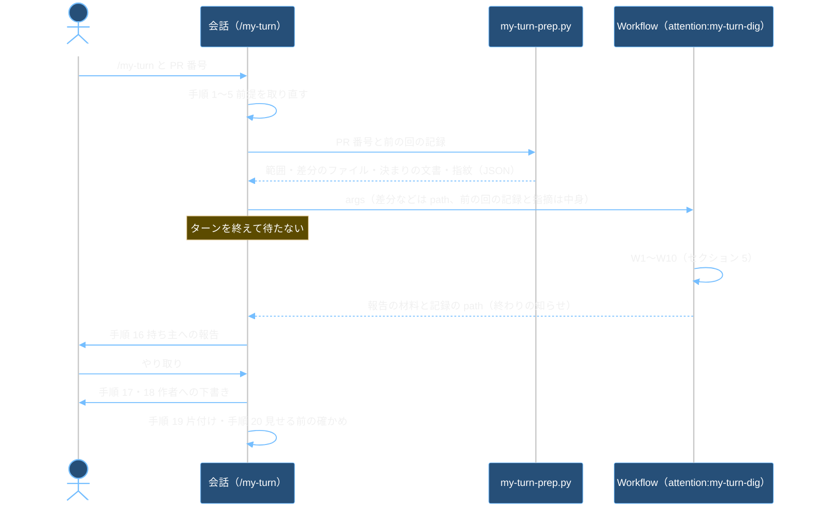
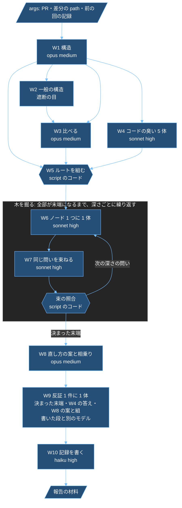
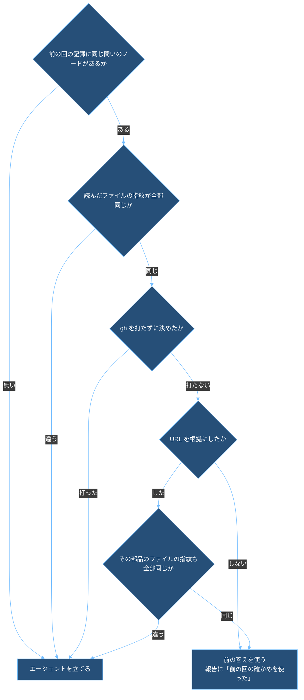

# /my-turn の掘る段を Workflow で回す設計（案）

/my-turn（attention のコマンド `commands/my-turn.md`。持ち主のターンの PR を進める）の、構造をとらえて木を掘る段を、Claude Code の Workflow（JavaScript の script が裏のエージェントを決まった順に回す仕組み。https://code.claude.com/docs/en/workflows ）に移す設計。
状態: 案（2026-11-16）。承認されるまで `commands/my-turn.md` は変えない。

呼び方: この文書のまとまりは「セクション N」、今の `commands/my-turn.md` の手順は「手順 N」、Workflow の段は「W1」〜「W10」。木の 1 つの問いを「ノード」、掘る出発点の問いを「ルート」と呼ぶ。head は PR のブランチの最新 commit。今の手順 1〜20 と守ることの本文は `commands/my-turn.md`（今の版）に在り、この文書はそれを直す所だけを書く。

語（今の手順と同じ意味）: 末端は、実物で確かめて答えが 1 つに決まる問い。正本は、同じ値が何か所かに在るときの元になる 1 か所。台帳は、既知の制約・判断・例外を書き並べた記録。自作は、世の中の定番で足りるのに手で作っている部分。世の中の解は、同じ問題を OSS・定番のツール・定番の手順がどう解いているか。相乗りは、1 つの直しで別の指摘も片づくことと、PR の外の issue・PR に乗れること。

語（この設計で足す物）: 指紋は、ファイルの中身から git が出す hash（`git hash-object` の値。git が中身ごとに付ける blob の hash と同じ）で、中身が 1 字でも違えば変わる。決まった末端は、W6 が「末端」と返したノード（指摘の根拠・「問題無い」と閉じた物・「消える」の根拠のどれも含む。「子に分ける」「未確認」と返したノードは含まない）。`<base7>`・`<head7>` は commit の hash の頭の 7 字。遮断の目は、差分もリポジトリも見せずに PR の種類の 1 文だけを渡し、同じ種類のシステムの一般の構造を描かせるエージェント（今の手順 7。定義の在る役〔例: convergence-loops の blind-judge〕を使う）。opus・sonnet・haiku・fable はモデルの別名で、能力の高い順に fable・opus・sonnet・haiku（fable がいちばん高く、1 トークンあたりもいちばん高い）。

## 1. ねらい

今の /my-turn の形（構造をとらえる → 一般の構造と比べる → 木を掘る → 反証 → 報告）は変えない。変えるのは回し方と、セクション 8 の手順の文の直しで、回し方は手順 11 の木の探索を、1 つの会話で順に回す形から、ノードごとに別のエージェントを立てる形にする。1 つの会話で回すと文脈は 1 つで、ノードが増えるほど 1 つあたりに割ける読みが減り、後ろのノードほど浅くなる。

あわせて次の 3 つを足す。

- コードの臭いを問う段（W4）。今の手順は設計の構造だけを問い、同じ事実の重なり・説明の量・台帳の中身・試験の重なり・育つ一覧を見る段が無い
- 差分と読む物を機械が揃える（`my-turn-prep.py`。範囲の確かめ・差分のファイル・PR の commit・決まりの文書・読まないファイル・指紋。セクション 4）
- 前の回の結果の使い回しを、読んだファイルの指紋で機械が決める（セクション 7）

ノードは読むだけで、試験を回す・写しで試す・ツールを入れることはしない。Anthropic の Code Review も「a review works from reading the diff and the surrounding code, without building or running your code」（https://code.claude.com/docs/en/code-review ）。動かさないと決まらない問いは「未確認」とし、何を動かせば決まるかを報告に書く。

## 2. 全体の形



- 会話に残すのは手順 1〜5 と 16〜20。報告と作者への下書きは、持ち主と何度もやり取りして詰めるので、報告を書いた文脈が会話に要る。
- Workflow はプラグインの `workflows/` に置き、`/attention:my-turn-dig` で呼べる（Workflow の文書の「Distribute a workflow in a plugin」）。会話は名前で呼び、入力を `args` で渡す。
- Workflow は裏で走る。会話は待ち続けずにターンを終え、終わりの知らせで手順 16 から続ける（Workflow の文書の「Watch the run」）。
- Workflow は途中で人の入力を受けない（Workflow の文書の「No mid-run user input」）。手順 13 の「それでも決まらなければ持ち主に聞く」は「決まらなかった問い」として返し、会話が手順 16 で持ち主に上げる。
- Workflow が使えない環境（`disableWorkflows` が真など）では、/my-turn は訳と直し方（`/config` の Dynamic workflows）を言って止まる。会話だけで回す道は残さない。2 つの道を持つと文が別々に直されてずれる。今の能力（Workflow 無しで回せる）を落とすので、セクション 13 に挙げる。
- /catchup との違いを `commands/my-turn.md` の頭に 1 文で書く: /catchup は持ち主がその場で答えを待つので裏のエージェントを立てない（一般の構造を遮断の目に描かせる 1 回だけは立てる。`attention/skills/catchup/SKILL.md` の守ること 5）。/my-turn は待てる手順なので、掘る段を裏の Workflow で回す。

## 3. 置くファイル

```
attention/
  commands/my-turn.md          直す。手順 1〜5・16〜20 と守ること。手順 5 の後で下ごしらえをし、Workflow を呼ぶ
  workflows/my-turn-dig.js     新規。Workflow の本体（1 本）
  scripts/my-turn-prep.py      新規。セクション 4 の下ごしらえ（範囲・差分のファイル・決まりの文書・指紋。標準ライブラリだけ。attention の台本の起動の入口 `scripts/run-python.sh` から起動）
tests/
  my-turn-prep-case.py         新規。一時の git リポジトリで下ごしらえを見る
  my-turn-dig-dry.mjs          新規。script を偽物の agent() で空回しする
  my-turn-dig-map.json         新規。今の手順 6〜15 の文 → 移した先の段（セクション 9）
<PR の作業場の git dir>/attention/my-turn/   PR のリポジトリには commit しない
  <PR番号>.json                 記録。W10 が書き、次の回の --prior に渡す
  <base7>..<head7>.diff         prep が書く。commit の一覧・--stat・-U10 の差分（前の回からの 2 本目も同じ形）
  <PR番号>-justifications.md   会話が書く。手順 4 で控えた、この PR が足した正当化
  <PR番号>-thread.md            会話が書く。PR の本文・コメント・レビュー
```

- Workflow の script はファイルもモジュールも読めない（Workflow の文書の「Behavior and limits」）。段の指示の文・返す形（JSON Schema）・上限の既定は、全部 `my-turn-dig.js` の中に書く。
- script の中の指示の文は AI だけが読むので英語で書く。今の手順 6〜15 の文を訳して移し、元の手順の番号を文のそばにコメントで残す（`tests/my-turn-dig-map.json` と照合する）。
- script が受け取る物は `args` だけ。差分と PR の会話の本文は載せず、ファイルの path を渡してエージェントに読ませる。例外は前の回の記録（`priorRecord`）と前の指摘（`priorFindings`）で、script のコードが使い回しとルートを決めるのに使うので、中身を載せる。

## 4. 差分の下ごしらえ（my-turn-prep.py）

エージェントを立てる前に、読む物を機械が揃える。やり方は世の中のレビューのツールの下ごしらえに倣う。`my-turn-prep.py <PR番号> [--prior <記録>]` が、手元の git から次を作り、path と値を JSON で出す。


- 範囲を決めて確かめる: PR の base のブランチを `git fetch` で取り直し、`origin/<base のブランチ>` と head の merge-base を base にする。merge-base が無い・範囲の commit が 0 個・手元の head が PR の head（`gh pr view --json headRefOid`）と違う、のどれかか、`git fetch` が失敗したら止まる。`HEAD~1` のような数え方は使わない。superpowers（Claude Code の公開のスキル集。https://github.com/obra/superpowers ）も、それをすると黙って commit を落とすと書く（https://github.com/obra/superpowers/blob/main/skills/subagent-driven-development/SKILL.md 「never `HEAD~1`, which silently truncates multi-commit tasks」）。
- 差分を 1 つのファイルにまとめる: commit の一覧と `git diff --stat` と `git diff -U10` を、範囲の名前のファイル（`<base7>..<head7>.diff`）に書く。読まないファイル（下）の差分は本文から外し、`--stat` にだけ残す。ノードには path だけを渡す。superpowers と同じ形で、会話の文脈に差分の本文を入れずに済む（同じ文書「Hand the reviewer its diff as a file」「The output never enters your own context」）。
- 前の回からの差分: `--prior` のとき、前の回の head から今の head までも同じ形で 2 本目を作る。Claude Code の Code Review も、push の後は前のレビューから変わった所を見る（https://code.claude.com/docs/en/code-review-pull-requests 「focuses on what changed since the last review」）。2 本目の使い方はセクション 5 の「2 回目の回し方」。PR 全体（base から head まで）の足した行と消した行が、前の回の記録の時点と同じ（空の commit や、base の取り込みだけの push）なら、`git patch-id` で見分けて 2 本目を作らない。Code Review も同じ場合はレビューを回さない（同じ文書「The pull request still adds and removes the same lines」。`git patch-id` で見分けるのはこちらの選び）。そのときは prep が「変わっていない」と返し、会話は Workflow を立てずに、前の回の記録の path と、変わっていないことを持ち主に言う。前の回の head が手元に無い（force-push の後で消えたなど）ときは、2 本目を作らず、前の回が無いものとして全部を回し、そのことを報告に書く。
- 決まりの文書を base から集める: リポジトリのルートの CLAUDE.md と、変えたファイルの親のフォルダの CLAUDE.md と、REVIEW.md（Claude Code の Code Review が読む、そのリポジトリのレビューの決まりを書くファイル）の path を、base の commit の版で出す（`git show <base>:<path>` で読む）。Code Review も同じ範囲を読み、REVIEW.md は PR の変更から読まない（https://code.claude.com/docs/en/code-review 「the `CLAUDE.md` files in the parent directories of each changed file」、https://code.claude.com/docs/en/code-review-customize 「never from the pull request's own changes」）。PR が決まりの文書を変えたなら、変えた後の版はレビューの対象にし、根拠にしない（守ること 3 と同じ線）。
- PR の commit: 範囲の commit の一覧（`git rev-list`）。守ること 3 の「入れた commit がこの PR の commit に在るか」を、ノードが `git blame` か `git log -L` で確かめるときに照合する先。
- 読まないファイル: lock のファイル（`*.lock`・`package-lock.json` など、script に決め打ちの一覧）だけを機械で外す。REVIEW.md に書く、読まないファイルの決まりは自然文で機械には読めないので、REVIEW.md をノードに渡し、ノードが従う。外したファイルは一覧で返し、報告に書く（黙って外さない）。
- 指紋: 変えたファイルと、前の記録のノードが読んだファイルの、今の head での指紋（セクション 7）。

数は機械で数えない。行数・重なる文・育つ一覧の数は、調べた範囲（pr-review-toolkit〔Anthropic の公式のプラグイン集にある PR のレビューのプラグイン〕・superpowers・Claude Code の Code Review）のどのツールも機械で出しておらず、差分と周りの文脈を渡して判断をエージェントに任せている。W4 は下ごしらえの差分を読んで答え、根拠を「ファイル:行」で返す（Code Review の REVIEW.md の例「behavior claims need a `file:line` citation」。https://code.claude.com/docs/en/code-review-customize ）。数え違いは W9 が反証で拾う。

## 5. Workflow の段

入力（`args`）: PR の番号（`pr`）・リポジトリ（`repo`）・作業場の path（`workdir`）・立場（`stance`。レビュアーか作者か）・下ごしらえの JSON（`prep`）・会話が書いたファイルの path（`files`。PR の会話〔`thread`〕・手順 4 で控えた正当化〔`justifications`〕・記録の書き先〔`record`〕）・前の回の記録の中身と、prep が出した今の指紋（`priorRecord`。script はファイルを読めないので、会話が記録を読んで中身を載せる）・手順 4 で控えた前の指摘と前の回の発見とその状態（`priorFindings`）・手順 5 で読めなかった物（`unread`）・上限（`limits`。ノードの数・W8 の案と組の数）・段ごとのモデルと effort の上書き（`models`）・遮断の目（ツールを持たず、渡した文だけで答える役。convergence-loops の `blind-judge`）の役の名前（`blindJudge`）・記録の日時（`now`）。

どの段も結果を JSON Schema で返す。どの段の指示にも、GitHub へ書き込まない（`gh` は読むだけ）と、作者の返事に書いた理由とこの PR が足した正当化を根拠にしない、を入れる。記録・例外の一覧・コメントの「なぜ」を理由に使う前に、その行を入れた commit を `git blame` か `git log -L` で確かめ、prep の PR の commit に在ればレビューの対象に数える（守ること 3）。手順 4 で控えた正当化（`files.justifications`）は、全部の段に path で渡す。



待つ所は 5 つ: W5 は W3 と W4 の全部を、W7 は深さごとの全部のノードを、W8 は木の全部を、W9 は W8 を、W10 は W9 の全部を待つ。W9 が W8 を待つのは、案と組の反証に W8 の答えが要り、末端と W4 の答えの反証だけ先に流しても、W10 で W8 の反証を待つので終わりが早くならないため。1 つの深さの中のノードと、W9 の 1 件ずつは待たずに流す。

- **W1 構造**（手順 6・10）: PR が触るシステムの構造（部品・流れ・正本・依存の向き・境目）を描き、PR の種類を 1 文で言う（種類は固定の分類表を持たず、W1 が自由な文で言う。例: 「設定の正本を移す PR」「新しい検査を足す PR」「外のツールに置き換える PR」。以下「W1 の種類の 1 文」）。PR が作る仕組みと、それが補う前提も出す。この PR が足す検査・試験の仕組みにも、それぞれの前提を言う（手順 10）。自作の部品の一覧も出す（差分の `--stat` で足した行の集まり方を入口に、主目的でない所〔検査・試験・つなぎ〕に多ければ自作の候補として先に挙げる）。部品の言えない PR なら、その旨を返し、W2・W3 を飛ばす。
- **W2 一般の構造**（手順 7・8）: 遮断の目に W1 の種類の 1 文だけを渡して描かせる。一般論しか返らなければ、伏せた問い（この PR が選んだ所を、答えを伏せて問う文。「正本をどちらに置くか」「境目をどこに引くか」など）を足して 1 回だけ問い直す。それでも出なければ、出なかったことを返す。遮断の目の役が入っていなければ、ツールを使うなと頼んだ既定の役（general-purpose）を opus・effort medium で立てる。
- **W3 比べる**（手順 8・9）: W1 と W2 を並べ、違いごとに寄せるか外れてよいかを、リポジトリの外の基準（W2 の一般の構造と、世の中の定番・公式の文書）で決める。理由にリポジトリの今の状態を使わせない。外れてよいとした違いごとに、同じ問題があと 3 回来たとき何が積み上がるかを言わせる。
- **W4 コードの臭い**: セクション 8 の 5 つの問いを 1 問ずつ別の 1 体が、下ごしらえの差分を読んで答え、根拠を「ファイル:行」で返す。W2・W3 と並べて走らせる。
- **W5 ルートを組む**（コード）: 前提を消す形（W1 が挙げた「それが補う前提」を取り除き、補う仕組みごと要らなくする形）はあるか（必ず 1 本・先頭。消す道は近い所から探す: まず変更の内側で消せないかを問い、システムをまたぐ設計の変更はその後に回す。手順 11）・W3 で寄せると決めた違い・W4 で臭いと答えた所・受けた指摘か前に出した指摘・前の回の発見で残っている物と未確認の物・PR が作る部品の全体への「世の中の解」（手順 13）・この PR より前から在る、本物のツール（パーサ・コンパイラなど）に処理させる検証の洗い出しと、この PR が足した物がその経路に乗っているか（手順 13。乗っていなければ穴）・W1 の自作の部品ごとの「世の中の解」と「自作を疑う」（手順 15）。PR の本文の枠と作者が頼んだ観点だけで組まない。
- **W6 木を掘る**（手順 11・13・15）: ノード 1 つに 1 体。{答え・確かめた物・決まったか（末端／子に分ける／未確認）・子の問い} を返す。全部のノードが末端か「未確認」になるまで掘る。深さの上限は置かない（今の手順 11 も「末端まで」で深さを決めていない）。浅い PR では木は自然に浅く終わる。根拠にできる出典は公式の一次の文書までで、二次の記事しか無ければ「未確認」に下げる。世の中の解を当てるノードは、ツールが一般の構造（W2）のどの部品を受け持つかを言い、PR が作る部品と同じ部品を受け持つ物だけを数え、「代わり」（まるごと置き換えられる）か「土台」（その上に作れば自前の処理が要らない）に分ける。上限で掘らなかった問いは「未確認」で残し、その上に乗る「消える」「要らなくなる」も「未確認」にする（守ること 5）。
- **W7 束ねる**（新しい段。今の手順には無い）: 深さごとに全部のノードを待つ。そこで出た子の問いの全部を 1 体に渡し、違う親が出した同じ問いを 1 つの束にさせる。束は次の深さで 1 つのノードになり、親を複数持つ（下の図）。すべての子の問いがどれか 1 つの束にちょうど 1 回入っているかを script のコードが確かめる。畳んだ問いと捨てた問いも、問いの鍵と結果の表（以下 `seen`）に覚え、次の深さで同じ問いを立て直さない。深さの区切りで待つのは W7 だけで、1 つの深さの中のノードは待たずに流す。


- **W8 直し方の案と相乗り**（手順 12・14）: 決まった末端の全部から、`limits` の数まで、直し方の案を手順 14 の順（要らなくする → 型で縛る → 出来合いのツール → 自作）で作り、案ごとに世の中の解を当て（手順 13 の「指摘の 1 件ずつとこちらの直し方の案に当てる」）、1 つの直しで片づく組と、壊し合う組を挙げる（以下、案と組。W7 の束とは別）。PR の外の open な issue・PR を `gh` で探し、探した語と、乗れるかを書く。
- **W9 反証**: 決まった末端の全部と、W4 の答えの全部と、W8 の案と組ごとに、別の 1 体が反証を試みる。渡すのは問い・答え・確かめた物だけで、親の見立てと兄弟の答えは渡さない。判定は「残る／崩れた／確かめられない」で、確かめられない物は崩れた扱いにせず「未確認」で残す。崩れた末端に乗る案と組は外す。「残る」は正しいと確かめた印として報告に書かない。
- **W10 記録と報告の材料**: 記録の中身は script のコードが組み、1 体がそれを記録のファイルに書き出す（中身をエージェントに組ませると形が揺れる）。会話には手順 16 と 20 に要る物だけを返す: W1 の構造と W2・W3 で使った問いの文・仕組みと前提・ルートごとの末端で分かったこと・案と組と判定・相乗り・W2 で一般の構造が出なかったか・決まらなかった問い・未確認・件数・記録の path。

2 回目の回し方（前の回の記録があるとき）: run は 1 回で、2 本の差分を両方使う。W1〜W4 は base からの差分（1 本目）を PR の全部として初めから読み直し、前の回の head からの差分（2 本目）で、前の回の後に足された所を印にする。W5 は、2 本目が触るファイルに当たるルートを、同じ種類のルート（W5 が並べる区分。前提を消す形・W3 の違い・W4 の臭い・指摘・前の回の発見・世の中の解・検証の洗い出しの穴・自作を疑う）の中で先に置く。前の指摘が直ったかの確かめ（手順 4）は会話がして `priorFindings` に載せ、W5 がルートか子の問いにする。前の回のノードを使うかは指紋で決まり（セクション 7）、2 本目が触ったファイルを読んだノードは必ず立て直しになる。

件数（立てた数・返った数・落ちたノード・上限で掘らなかった問い）は script のコードが数える。`agent()` が `null` を返したノードは「該当なし」でなく「未確認」とし、1 体の失敗で run 全体を止めない（Workflow の文書の「Behavior and limits」）。落ちたノードと掘らなかった問いは、問いの文も返す。

## 6. ノードからノードへの受け渡し

1 つの会話の木の探索では、親で読んだ物が文脈に残り、子がそのまま使えた。ノードごとに別のエージェントにすると、子は親の文脈を持たない。何も渡さなければ子は同じファイルを読み直し、全部渡せば文脈が膨らんで元の問題に戻る。そこで、親から子へは「要る物を短く、本文でなく在り処で」渡す。Anthropic の調べの仕組みも、子が結果を外に置き、軽い参照だけを親に返す（https://www.anthropic.com/engineering/multi-agent-research-system 「store their work in external systems, then pass lightweight references back to the coordinator」）。同じ記事は、子への頼みに「an objective, an output format, guidance on the tools and sources to use, and clear task boundaries」を書くよう求める。子どうしは直に話さず、script を通す。

ノードへの指示は次の順に組む。1 と 2 は全部のノードで同じ字にし、プロンプトのキャッシュを分け合わせる（Workflow の文書の「Cost」）。

1. 決まりの文
2. PR の土台: W1 の構造の要約・W2 の一般の構造の要約・差分のファイルと決まりの文書の path・読まないファイル
3. 通ってきた道: ルートからこのノードまでの、問いと答えの 1 行ずつ（祖先が決めた事を決め直さないため）。W7 で親を複数持ったノードは、親ごとの道を全部渡す
4. 親が確かめた物の在り処: ファイルと行の範囲・指紋・URL。本文は貼らない
5. このノードの問いと、受け持つ範囲の境（ここで決める事と、子に回す事）


子が返す物も短くする。答えは数行まで、確かめた物は在り処で返す。子の問いには、問う訳と見るとよい在り処を 1 行ずつ添え、孫への指示の項目 4 に使う。兄弟の答えは渡さない（重なりは W7 が束ねる）。

ノードの数の上限は深さごとに割り当てる。残りの数を親の数で均等に分ける。親を複数持つノードは、W5 の順で先のルートに属す親の分に数え、その親の並びの先頭に置く（2 つの親に効く問いなので先に掘る）。親の分より問いが多ければ、その親の並びの後ろから切って「未確認」にする。問いが分より少ない親の余りは、W5 の順で次の親に回す。来た順に詰めないのは、先に返ったルートが数を使い切り、後ろのルートが浅くなるのを防ぐため。

例: 残りが 12 で、次の深さの問いが、ルート 1 の下の親 p1 から 6 個、ルート 2 の下の親 p2 から 6 個、p1 と p2 の両方から出て束ねた問いが 3 個なら、束ねた 3 個は先のルート 1 の p1 に数える。p1 が 9 個・p2 が 6 個で計 15 個になり、均等の割り当ては 6 個ずつ。p1 の並びは束ねた 3 個が先で、p1 だけの 6 個が後ろなので、p1 だけの問いの後ろの 3 個を切って「未確認」にし、p2 は 6 個とも掘る。束ねた問いは 1 つのノードなので、切られるなら p1 側で 1 回だけ切られて「未確認」になり、p2 側だけで掘られることも、両方で切られることも無い。割り当てより問いの少ない親が居れば、余った数を W5 の順で次の親に回す。

## 7. 前の回の結果の使い回し

Workflow の resume は使わない。resume は同じ会話の中でしか効かず（Workflow の文書の「Resume after you leave the session」）、最初にプロンプトが変わった agent から後ろを全部回し直す（「Which agents run again」）。/my-turn の 2 回目は別の会話で回すことが多く、head が変われば W1 から後ろが全部回し直しになる。

代わりに script が明示で持つ。

- 記録（`<git dir>/attention/my-turn/<PR番号>.json`）に、その回の head と base と、ノードごとの問い・答え・確かめた物（読んだファイルと指紋・打ったコマンド・URL）・判定を残す。
- 次の回、会話は `my-turn-prep.py --prior <記録>` で今の指紋を出し、記録の中身と一緒に `args` の `priorRecord` に載せる。script は、同じ問い（問いの文の一致でなく、W5 がルートに・W7 が束に付ける問いの鍵〔`seen` の key〕が同じこと）のノードで、読んだファイルの指紋が全部同じで、`gh` を打っていないときだけ前の答えを使い、エージェントを立てない。git の読むだけのコマンド（`blame`・`log`・`show`）の答えは、読んだファイルが同じなら同じなので条件に入れない。`gh` の答え（open な issue・PR など）は GitHub の今の状態で変わるので、打ったノードは使い回さない。今の手順 4 は「ツールの版」が同じことも条件にするが、ノードはツールを動かさないので外す（セクション 13）。
- URL を根拠にしたノード（世の中の解）は、その部品のファイルの指紋が全部同じときだけ使う。
- W1・W3・W4 は head が変われば必ず立て直す。W2 は W1 の種類の 1 文が前の回と同じときだけ使う（手順 7）。
- 使ったノードは、報告の「確かめた前提」に「前の回の確かめを使った（何が同じか）」と書く（手順 4）。



## 8. 手順の文の直し

- 手順 2: head が手元と違えば、`/catchup <番号>` で PR のブランチへ移ってから呼び直すよう言って止まる。
- 手順 4: push の後は、前の指摘の確かめとは別に、前の回の head から今の head までの差分を、初めて見る PR として構造の段から回す（回し方はセクション 5 の「2 回目の回し方」）。差分のファイルは全部読む（読まないファイルは `--stat` にだけ載る）。この PR が足した正当化の控えは `<PR番号>-justifications.md` に書き、Workflow に path で渡す。
- コードの臭いの 5 つの問い（W4。答えを木のルートにする）:
  1. 同じ事実を何か所に書いているか。2 か所以上なら、1 か所から作れないか
  2. ファイルごとのコードと説明の比はどうか。説明が多い所は、コードが何を言えていないから補っているのか
  3. 足した例外・台帳・無視の設定の項目は、受け入れたリスクと、気づける事象で書いた見直す条件を持つか
  4. 足した試験は、既存の試験と重なっていないか。外のツールの中身に縛られていないか
  5. 版や事例が増えるたびに 1 行ずつ足す一覧を作っていないか。足し続けずに済む出どころは無いか
- 手順 13: 前の回の比べは、該当の部品が変わっていないときだけ使う（セクション 7 の指紋で機械が決める）。
- 手順 15: 手で並べた一覧（番号・型・特例の表）も自作に数える。
- 手順 17: 作者への文に直し方もヒントも書かない。文脈（作者自身の前の返事・台帳などの決まり）から入り、「こうなったとき、このコードだとこう困る」で止める。「ここはどう考えていますか」で揃えず、リポジトリにコメントの頭に付ける印（nit・suggestion など、指摘の重さや種類を示す語）の決まり（REVIEW.md など）があれば、その決まりが挙げる印の中から、指摘の中身に合う物を選んで付ける。直し方の案は持ち主への報告（手順 16）にだけ書く。根拠は Google の eng-practices（https://google.github.io/eng-practices/review/reviewer/comments.html 「Pointing out problems and letting the developer make a decision often helps the developer learn」）。
- 手順 19: 試験を動かさないので、会話が作った一時のファイルの片付けだけにする。
- 手順 20: W4 の答え・W9 の判定・落ちたノードと掘らなかった問いが報告に在るか、を足す。「入れたツール」の確かめは外す。
- 守ること 3: 作者の返事に書いた理由も、この PR が足した正当化に数える。

## 9. 今の手順の行き先

移し替えで元の能力を気づかずに削らないよう、今の手順の文は、セクション 13 の 2・3・9 に挙げて落とす物のほかは 1 つも落とさない。

- 手順 1〜5・16〜20 と守ること: `commands/my-turn.md` に残す（セクション 8 のとおり直す）。
- 手順 6〜15: 英語に訳して段の指示に移す。手順 6・10 → W1。手順 7 → W2。手順 8 → W2・W3。手順 9 → W3。手順 11 → W5（ルートの決め方）・W6（掘り方。動かして確かめる道は外す）。手順 12 → W8。手順 13 → W5・W6・W8。手順 14 → W8。手順 15 → W5・W6。
- 照合: `tests/my-turn-dig-map.json` に、手順 6〜15 の文の 1 つずつと移した先の段を書き、表に無い文があれば赤にする。訳した文の中身が移った先に在るかは、作った会話と別の目が表を見て照合する。

## 10. モデルと上限

モデルは能力の上下で書く（`opus` が能力の高い側、`sonnet` が低い側、`haiku` がいちばん安い側）。決め方は、持ち主のノート my_notes の `.claude/AGENTS.md` の「モデル」と、Anthropic の effort の文書のモデルごとの推奨（https://platform.claude.com/docs/en/build-with-claude/effort ）に合わせる。Workflow で `effort` を書かなければ会話の effort を継ぐので、段ごとに `model` と `effort` を両方書く（https://code.claude.com/docs/en/workflows ）。

モデルごとの推奨（effort の文書から）:

- Opus 5.5: 既定は medium。たいていのエージェントの仕事は既定の medium から始める（https://platform.claude.com/docs/en/about-claude/models/optimizing-for-cost-and-intelligence 「For most agent workloads, start with Claude Opus 5.5 at its default effort (`medium`)」）。
- Sonnet 5.5: 既定は high。エージェントの複数段のツールの仕事は、仕様の決まった物を medium、難しい物や長い物を high から始める（「For agentic coding and multistep tool use, start with `medium` for well-specified tasks and move to `high` for harder or longer ones」）。
- Haiku 5.5: 既定は medium。決まった形を守らせる仕事は high（「Use `high` for knowledge work, longer agent tasks, and strict instruction following」）。

my_notes の「モデル」から取る決まり:

- 誤りを後ろの段が止める手を動かす段は、能力の低い側を effort high にし、medium にしない（コーディングのエージェントの評価〔CursorBench〕で medium が high より点が低かったため）。
- 誤りを後ろで止める段が無い判断は、能力の高い側を effort medium にする。
- 費用や速さを変えるときは、モデルの前に effort を動かす。手を抜いて間違えたなら effort を、文脈が揃っていて試したのに間違えたならモデルを上げる。
- 照合する役（反証）は、書いた役と別のモデルにする。

| 段 | model | effort | 後ろで止める段 |
|---|---|---|---|
| W1 構造・W3 比べる | opus | medium | 無し |
| W2 一般の構造 | 遮断の目の定義のまま | 定義のまま | 無し |
| W4 コードの臭い・W6 木のノード | sonnet | high | W9 |
| W7 束ねる | sonnet | high | script の照合 |
| W8 案と相乗り | opus | medium | W9 |
| W9 反証（W4・W6 の答え） | opus | medium | 無し |
| W9 反証（W8 の案と組） | sonnet | high | 無し（下の例外） |
| W10 記録の書き出し | haiku | high | script の照合 |

- W4・W6 は、差分とコードを読んで問いを掘る長い仕事なので、Sonnet 5.5 の推奨の「harder or longer」に当たり、my_notes の決まりとも合う high にする。W7 は答えの文を束ねるだけでツールを使わないが、my_notes の決まりに合わせて high にする。
- W8 は W9 が反証するが、木の全部の末端を見渡して案を組む判断なので能力の高い側に残す。その反証は後ろで止める段が無いので、上の決まりでは opus の medium になるが、書いた段（opus）と別のモデルにする決まりと両立しない。別のモデルにする方を採り、sonnet にして effort を high にする（例外）。
- W2 の遮断の目の定義が無いときの既定の役（general-purpose）は、後ろで止める段が無いので opus の medium で立てる。
- W10 は script が組んだ中身をファイルに書き出すだけの機械的な仕事なので、いちばん安い側にし、形を崩さないよう high にする。書いた後に script が中身を照合する。
- 一番能力の高い fable は既定にしない。1 トークンあたりがいちばん高く、ノードの数だけ掛かるため。段ごとのモデルと effort は `args` の `models` で替えられるようにする。替えた結果、反証が書いた段と同じモデルになるなら、script は run を始めずに止める。
- 懸念: Anthropic の計測では、仕事を安いモデルに配って得をしたのは「決まった仕事で費用の長い裾がある」ときと「1 つの文脈に収まらない」ときだけで、1 つの文脈に収まる仕事は、指揮するモデル 1 体を低い effort で回す方が全部の場合で上回った（https://platform.claude.com/docs/en/about-claude/models/optimizing-for-cost-and-intelligence の「Orchestrator strategy」の項）。/my-turn を Workflow にする訳は、1 つの会話では後ろのノードほど浅くなることで、木の全部が 1 つの文脈に収まらないことに当たる。小さい PR では木は自然に浅く終わる（ノードが「末端」を返せば掘らない）。また差分の全部を読む段（W3・W5）が残るので、分けたせいで全体を見落とす心配は小さい。残るのは費用で、木の深さに依らない段（W1〜W4・W8・W10 と、W4 の答えの反証。W5 はコードで体を立てない）だけで 15〜16 体立つ。実装の後の前の版と直した版の 1 対（セクション 12）で、小さい PR での費用と時間が今の 1 つの会話と比べて見合うかを見る。
- 上限の既定はノード 80・W8 の案と組 15。`args` と /my-turn の引数で替えられる。ノードの上限は、問いが問いを生み続けて止まらないときの歯止めで、ふつうの PR では当たらない数にする。当たって掘らなかった問いは「未確認」として報告に出す。深さの上限は置かない。同じ問いを 2 度掘らないこと（`seen`）とノードの上限で止まるので、深さで切ると末端まで確かめる今の手順 11 の能力を落とすだけになる。
- W1・W2・W3 と W10 は反証しない。W1〜W3 は後ろで止める段の無い判断なので能力の高い側にし、W10 は script が照合する。
- 1 回の体数の見込みは 70〜200 体（W1〜W4 で 8〜9・ノードで 30〜80・反証で 30〜100〔決まった答えは多くてもノードの 80 と W4 の 5 で、そこに W8 の案と組の上限 15 が足される〕・束ねと W8・W10 で 3〜6）。Workflow の上限（1 回 1,000 体・同時に 16 体）の中に入る。25 体を超えると進み具合の行に `Large workflow` の警告が出るが、止めはしない（Workflow の文書の「Cost」）。
- トークンは未測定。

## 11. script の骨組み

形を見るための骨組みで、指示の文と返す形は省いてある。

```js
export const meta = {
  name: 'my-turn-dig',
  description: 'Dig the /my-turn question tree for one PR and return report materials',
  whenToUse: 'Called by /attention:my-turn after steps 1-5; not for direct use',
  phases: [
    { title: 'Structure' }, { title: 'Compare' }, { title: 'Dig' },
    { title: 'Fix options' }, { title: 'Refute' }, { title: 'Record' },
  ],
}

const A = args            // { pr, repo, workdir, stance, prep, files, priorRecord, priorFindings,
                          //   unread, limits, models, blindJudge, now }
const MODELS = {          // section 10; args.models overrides per stage
  W1: { model: 'opus', effort: 'medium' },  W3: { model: 'opus', effort: 'medium' },
  W4: { model: 'sonnet', effort: 'high' },  W6: { model: 'sonnet', effort: 'high' },
  W7: { model: 'sonnet', effort: 'high' },  W8: { model: 'opus', effort: 'medium' },
  W9answers: { model: 'opus', effort: 'medium' }, W9fixes: { model: 'sonnet', effort: 'high' },
  W10: { model: 'haiku', effort: 'high' },
  W2fallback: { model: 'opus', effort: 'medium' },   // only when no blind-judge role
}
const M = stage => ({ ...MODELS[stage], ...(A.models?.[stage] ?? {}) })
if (M('W9answers').model === M('W6').model || M('W9answers').model === M('W4').model ||
    M('W9fixes').model === M('W8').model) return { failed: 'refuter model equals writer model' }
const RULES = `...`       // shared rules: read-only, never write to GitHub, never cite the
                          // author's reasons or PR-added justifications ...
const ask = (stage, body, opts) =>       // same head for every node: RULES first, the node's own text last
  agent(`${RULES}\n\n## Stage ${stage}\n${body}`, opts).catch(() => null)

phase('Structure')
const structure = await ask('W1', W1_PROMPT(A), { schema: STRUCTURE, ...M('W1') })
if (!structure) return { failed: 'W1' }

phase('Compare')                         // W2/W3 and W4 run side by side
const [compare, smells] = await parallel([
  async () => {
    if (structure.noParts) return null
    const general = reuseGeneral(structure.oneLine, A.priorRecord)   // same kind sentence as last run (section 7)
      ?? await ask('W2', W2_PROMPT(structure.oneLine), A.blindJudge ? { schema: GENERAL, agentType: A.blindJudge }
                                          : { schema: GENERAL, agentType: 'general-purpose', ...M('W2fallback') })
    return general && { general, diff: await ask('W3', W3_PROMPT(structure, general),
                                                 { schema: COMPARE, ...M('W3') }) }
  },
  () => parallel(SMELL_QUESTIONS.map(q => () =>
          ask('W4', W4_PROMPT(q, A.prep), { schema: NODE, ...M('W4') }))),
])

const roots = buildRoots(structure, compare, smells, A)   // W5: plain code, no agent

phase('Dig')
const seen = new Map()      // question key -> node, including folded and dropped ones
let level = roots, used = 0
while (level.length) {                                   // no depth limit; the node cap stops runaways
  const share = allot(level, A.limits.nodes - used)      // even share per parent, root order on cut
  const answers = await pipeline(share.kept, n =>
    reuse(n, A.priorRecord) ?? ask('W6', W6_PROMPT(structure, n), { schema: NODE, ...M('W6') }))
  used += share.kept.length
  markUnverified(seen, share.cut)                         // never silently dropped
  const merged = await ask('W7', W7_PROMPT(answers), { schema: CLUSTERS, ...M('W7') })
  level = checkClusters(merged, answers, seen)            // every child exactly once; seen stops re-asks
}

phase('Fix options')
const fixes = await ask('W8', W8_PROMPT(decidedLeaves(seen)), { schema: FIXES, ...M('W8') })

phase('Refute')                       // only question + answer + evidence; no parent, no siblings
const verdicts = await parallel(refutable(seen, smells, fixes).map(x => () =>   // refuter model != writer model
  ask('W9', W9_PROMPT(x), { schema: VERDICT, ...M(x.fromFix ? 'W9fixes' : 'W9answers') })))

phase('Record')
const record = buildRecord(A, structure, compare, smells, seen, fixes, verdicts)
const wrote = await ask('W10', W10_PROMPT(record, A.files.record), { schema: WROTE, ...M('W10') })
return materials(record, wrote, counts(seen, verdicts))   // counts: started / returned / null / cut
```

- `buildRoots`・`allot`・`reuse`・`markUnverified`・`checkClusters`・`decidedLeaves`・`refutable`・`buildRecord`・`materials`・`counts` は、エージェントを立てない普通の関数で、同じ入力に同じ答えを返す。
- `Date.now()` と `Math.random()` は script の中で使えない（Workflow の文書の「Behavior and limits」）。記録の日時は `args` の `now` で受け取る。

## 12. 試験

- `tests/my-turn-prep-case.py`: 一時の git リポジトリで、merge-base が無い・範囲が空・head が PR と違う（`gh` を偽物に替える）・`git fetch` が失敗する、のそれぞれで止まるか、差分のファイルの中身、CLAUDE.md と REVIEW.md を base の版で出すか、前の回の head が無いときに 2 本目を作らず全部を回す扱いか、`--prior` の 2 本目と、足した行が同じ push で 2 本目を作らないか、PR の commit の一覧、lock のファイルが本文から外れて `--stat` に残るか、指紋の照合を見る。
- `tests/my-turn-dig-dry.mjs`: script を、`agent()` などを偽物に替えて node で空回しする。偽物の `agent()` は、渡された JSON Schema に合う決まった答えを返す。深さごとの割り当て（セクション 6 の例の数）・束ねの検証・使い回し（W6 のノードと W2）・`null` を「未確認」にする扱い・件数・反証と書いた段が同じモデルのときに止まるかを、エージェントを立てずに毎回同じ答えで確かめる。JSON Schema の自己矛盾（`required` が `properties` の外）もここで見る。
- `tests/run.sh` に、上の 2 本と `tests/my-turn-dig-map.json` の照合を足す。
- エージェントの答えの中身は手元の試験では見られない。実装の後に、同じ PR を前の版と直した版で 1 回ずつ回して比べる。

## 13. 承認で見てほしい点

1. 今の /my-turn の形は変えず、手順 6〜15 の木の探索を、ノードごとに別のエージェントを立てる Workflow に移す（セクション 1・2）
2. Workflow が使えない環境では止まり、会話だけで回す道を残さない。今の能力を 1 つ落とす（セクション 2）
3. ノードは読むだけで試験を動かさない。今の手順 11 の「読むだけで決まらなければ動かして確かめる」を外す（セクション 1）
4. 親から子へは本文でなく在り処と通ってきた道を渡す（セクション 6）
5. 前の回の使い回しは resume でなく、読んだファイルの指紋で script が決める（セクション 7）
6. 深さの上限は置かず、ノードの上限 80 を歯止めにする。1 回 70〜200 体の見込み。段ごとのモデルと effort（セクション 10）
7. 小さい PR でも木の深さに依らない段で 15〜16 体立つ費用を、実装の後の 1 対で今の 1 つの会話と比べる（セクション 10 の懸念）
8. 行数などの数は機械で数えず、下ごしらえは範囲の確かめ・差分のファイル・PR の commit・決まりの文書・読まないファイル・指紋にする（セクション 4）
9. 今の手順 4 の使い回しの条件「ツールの版が同じ」と、手順 20 の「入れたツール」の確かめを外す。ノードがツールを動かさないため。今の能力を落とす物に数える（セクション 7・8）
10. 違う親が出した同じ問いを束ねる段（W7）を新しく置く（セクション 5）
11. コードの臭いを問う段（W4）を新しく置き、5 つの問いの答えを木のルートにする（セクション 5・8）
12. 手順の文を直す。特に手順 17 で、作者への文に直し方もヒントも書かない形にする（セクション 8）
