# darkfactory の設計図（役と情報の流れ）

地図の元（`darkfactory` の工程の YAML から組んだ graph.json）・節の `description:` の目的の 1 行・受け手の表（各モジュールの `RECEIVES` と `promptsection.Section` の宣言）から機械で作った文書。手で書かない（`uv run --no-project --with pyyaml python3 works/dev/graphmap_build.py build works` で作り直し、`check works` と試験 `tests/test_graphmap.py` が古さを見る）。

- 図: 箱は AI の役、`⇒` はブロックの工程を呼ぶ節、ひし形は人の関所、囲みは輪（`⟳` の後は上限の周）。機械の節は描かない
- 矢印: 順（depends_on）。字は後の節が `when`・`with` で読む返答の欄（矢印の元の節の欄は `欄`、間の機械の節の欄は `節.欄`）
- 表: 節の何をするか・機械が役の指示書に貼る節の数・受け取る物（`with` の欄 ← 節.返答の欄・入力.名・字の値）と、貼る節の出どころ・受ける役・入る条件の関数
- 「設計に無い」: 宣言から引けない物（目的の 1 行の無い節・受け手の表に行の無い役）。指示書や docstring から拾い直さない。受け手の表は貼る節が 0 の役と書き忘れの役を分けないので、どちらもこう出る

## 線 darkfactory

```mermaid
flowchart TD
  N_entering["entering ⇒ blk-entry"]
  N_ci_checking["ci-checking ⇒ blk-ci"]
  N_speccing["speccing ⇒ blk-spec"]
  N_pr_checking["pr-checking ⇒ blk-pr"]
  N_premising["premising ⇒ blk-premises"]
  N_purposing["purposing ⇒ blk-purpose"]
  N_worlding["worlding ⇒ blk-world"]
  N_gathering["gathering ⇒ blk-material"]
  N_judging["judging ⇒ blk-judge"]
  N_structuring["structuring ⇒ blk-structure"]
  N_planning["planning ⇒ blk-plan"]
  N_policy_gate{"policy-gate"}
  N_fixing["fixing ⇒ blk-fix"]
  N_replanning["replanning ⇒ blk-plan"]
  N_replan_gate{"replan-gate"}
  N_refitting["refitting ⇒ blk-fix"]
  N_rejudging["rejudging ⇒ blk-rejudge"]
  N_lensing["lensing ⇒ blk-lens"]
  N_reviewing["reviewing ⇒ blk-delta"]
  N_refixing["refixing ⇒ blk-refix"]
  N_testing["testing ⇒ blk-tests"]
  N_ci_final["ci-final ⇒ blk-ci"]
  N_measuring_after["measuring-after ⇒ blk-structure"]
  N_eyeing["eyeing ⇒ blk-eyes"]
  N_final_gate{"final-gate"}
  N_reporting["reporting ⇒ blk-report"]
  N_ci_checking -->|"h-entry.spec_go"| N_speccing
  N_ci_final --> N_measuring_after
  N_entering -->|"ci_role_go"| N_ci_checking
  N_eyeing -->|"h-final.ask"| N_final_gate
  N_final_gate -->|"report.ai_report_go, report.report_file"| N_reporting
  N_fixing -->|"h-replan.go"| N_replanning
  N_gathering --> N_judging
  N_judging -->|"h-plan.go, h-plan.structure_units_file"| N_structuring
  N_lensing --> N_reviewing
  N_measuring_after -->|"h-look.go"| N_eyeing
  N_planning -->|"h-gate.ask"| N_policy_gate
  N_policy_gate -->|"h-depth.unit_depths, h-fix.go, h-fix.judgment_file, h-fix.notes_file, h-fix.open_units, h-fix.plan_file, h-fix.ripple_file"| N_fixing
  N_pr_checking --> N_premising
  N_premising -->|"h-judge.premises_file, h-judge.purpose_go"| N_purposing
  N_purposing -->|"h-mat.world_go, h-mat.world_purpose_file"| N_worlding
  N_refitting -->|"h-rejudge.go"| N_rejudging
  N_refixing -->|"h-tests.go"| N_testing
  N_rejudging -->|"h-review.go"| N_lensing
  N_replan_gate -->|"h-refit.go, h-refit.judgment_file, h-refit.notes_file, h-refit.open_units, h-refit.plan_file, h-refit.ripple_file"| N_refitting
  N_replanning -->|"h-regate.ask"| N_replan_gate
  N_reviewing -->|"h-refix.go"| N_refixing
  N_speccing -->|"h-spec.pr_go"| N_pr_checking
  N_structuring --> N_planning
  N_testing -->|"h-ci.go"| N_ci_final
  N_worlding --> N_gathering
```

| 節 | 種類 | 何をする | 機械が貼る節 | 受け取る物 |
| --- | --- | --- | --- | --- |
| entering | ⇒ blk-entry | 起動の関所を越えたら、入口の入力を 1 つの形に揃え、盤面と修正前の CI の段を開く | - | adapter ← 入力.adapter, base ← 入力.base, design_only ← 入力.design_only, features_off ← 入力.features_off, features_on ← 入力.features_on, final_gate ← 入力.final_gate, fix_fixture ← 入力.fix_fixture, gates ← 入力.gates, lang ← 入力.lang, launch_mark ← 入力.launch_mark, policy_md ← 入力.policy_md, pr ← 入力.pr, request ← 入力.request, spec ← 入力.spec, test_cmd ← 入力.test_cmd, thickness ← 入力.thickness, unattended ← 入力.unattended |
| ci-checking | ⇒ blk-ci | 宣言の CI を機械で走らせられない run で、CI を任せ先の役が回す | - | node ← p0.local_checks |
| speccing | ⇒ blk-spec | 判定の前に、仕様（要件と受け入れ条件のテスト）を書いて人が承認する | - | base_rev ← entering.base_rev |
| pr-checking | ⇒ blk-pr | 並行して開いている PR との重なりを確かめる | - | - |
| premising | ⇒ blk-premises | 依頼の数値・在る無いの主張をコマンドで実測する | - | base_rev ← entering.base_rev, request ← 入力.request |
| purposing | ⇒ blk-purpose | 依頼の元の目的を 1 つの文に固める | - | base_rev ← entering.base_rev, constraints_file ← h-judge.premises_file, pr_file ← entering.pr_file, request ← 入力.request |
| worlding | ⇒ blk-world | 依頼の行を問題の類に言い直し、世の中の定石を集めて依頼の解き方と比べる | - | purpose_file ← h-mat.world_purpose_file, request ← 入力.request |
| gathering | ⇒ blk-material | 判定の前に、差分を P1 の目と先行議論に見せて素材を集める | - | adapter ← entering.adapter |
| judging | ⇒ blk-judge | 依頼を根本の単位にまとめる判定（直す義務の元） | - | base_rev ← entering.base_rev, policy_paste ← entering.policy_paste, premises_file ← h-judge.premises_file, request ← 入力.request, verify ← entering.judge_verify |
| structuring | ⇒ blk-structure | 判定の単位が名指すファイルの構造を実測し、汚れるかを判定する | - | policy_path ← entering.policy_path, units ← h-plan.structure_units_file |
| planning | ⇒ blk-plan | 独立設計・修正案（項目ごとの範囲とテスト）・事前審査の壁打ち | - | review_tree ← entering.review_tree, verify_file ← h-plan.verify_file |
| policy-gate | 人の関所 | 修正の前の人の関所（要る時だけ） | - | - |
| fixing | ⇒ blk-fix | 修正: 単位ごとの TDD の輪（枝を並べて 3 方向で合わせる）と修正役 | - | base_rev ← entering.base_rev, fix_lanes ← entering.fix_lanes, judgment_file ← h-fix.judgment_file, notes_file ← h-fix.notes_file, open_units ← h-fix.open_units, plan_file ← h-fix.plan_file, plan_session ← plan, policy_path ← entering.policy_path, ripple_file ← h-fix.ripple_file, tdd_lanes ← entering.tdd_lanes, tdd_suite ← 入力.tdd_suite, test_cmd ← entering.test_cmd, unit_depths ← h-depth.unit_depths |
| replanning | ⇒ blk-plan | 案の直し（修正の段の裁定が案の項目の誤りとした時だけ） | - | replan ← true, review_tree ← entering.review_tree |
| replan-gate | 人の関所 | 案の直しの人の関所（要る時だけ） | - | - |
| refitting | ⇒ blk-fix | 直した案で 2 回目の修正 | - | base_rev ← entering.base_rev, fix_lanes ← entering.fix_lanes, judgment_file ← h-refit.judgment_file, notes_file ← h-refit.notes_file, open_units ← h-refit.open_units, plan_file ← h-refit.plan_file, plan_session ← plan, policy_path ← entering.policy_path, ripple_file ← h-refit.ripple_file, tdd_lanes ← entering.tdd_lanes, tdd_suite ← 入力.tdd_suite, test_cmd ← entering.test_cmd |
| rejudging | ⇒ blk-rejudge | 修正役が判定に異議を出した時の再審 | - | - |
| lensing | ⇒ blk-lens | 修正の後の局所レビュー（レンズ） | - | - |
| reviewing | ⇒ blk-delta | 修正の差分の審査（新しい穴と塞いだ穴の検算） | - | base_rev ← entering.base_rev |
| refixing | ⇒ blk-refix | 差分の審査の穴の手直し | - | base_rev ← entering.base_rev, policy_paste ← entering.policy_paste, policy_path ← entering.policy_path |
| testing | ⇒ blk-tests | 最後のテスト（木の全部で 1 回） | - | cmd ← entering.test_cmd |
| ci-final | ⇒ blk-ci | 最後のテストを機械で走らせられない run で、任せ先の役が回す | - | node ← p4.ci |
| measuring-after | ⇒ blk-structure | 直しの後の差分で、設計の考えを知る場所の増減・新しい名・写しの塊を測る | - | base_rev ← entering.base_rev |
| eyeing | ⇒ blk-eyes | 独立の目（冗長と最小性・独立設計との比較・整合・範囲） | - | skip_optional ← h-redepth.skip |
| final-gate | 人の関所 | 最後の人の関所 | - | - |
| reporting | ⇒ blk-report | AI の報告と初見の検査 | - | machine_report ← report.report_file |

## ブロック blk-ci

呼ぶ節: ci-checking・ci-final

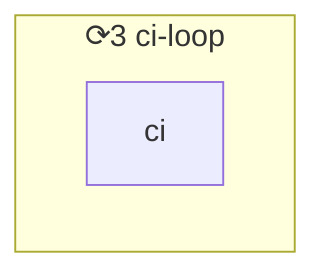

| 節 | 種類 | 何をする | 機械が貼る節 | 受け取る物 |
| --- | --- | --- | --- | --- |
| ci-loop | ⟳3 | 設計に無い | - | - |
| ci | AI | CI の任せ先: 対象の CI の定義を読み、写しの上でテスト・lint を走らせて結果を返す | 1 | - |

| 機械が貼る節 | 出どころ | 受ける役 | 入る条件 |
| --- | --- | --- | --- |
| 前の回の受け付けが拒んだ理由 | fn:ci_role.prep | ci | ci_role.prep |

## ブロック blk-delta

呼ぶ節: reviewing

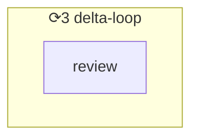

| 節 | 種類 | 何をする | 機械が貼る節 | 受け取る物 |
| --- | --- | --- | --- | --- |
| delta-loop | ⟳3 | 設計に無い | - | - |
| review | AI | 差分の審査役: この周の修正の差分だけを読み、修正が新しく作った穴を返す（読むだけ） | 3 | - |

| 機械が貼る節 | 出どころ | 受ける役 | 入る条件 |
| --- | --- | --- | --- |
| 下請けの型（superpowers の {file}。works の節で包んだ物） | fn:seat.section | review | seat.section |
| 借りたスキルの座 | fn:seat.section | review | seat.section |
| 判定の語の欄（型の語がどの欄のどの値に当たるかを示すだけ。欄の値は commands/delta-review.md の『2 つの判定』の決まりで返答の行から決まり、この表と食い違えば指示書が勝つ） | fn:seat.words_table | review | seat.words_table |

## ブロック blk-entry

呼ぶ節: entering

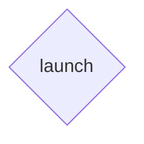

| 節 | 種類 | 何をする | 機械が貼る節 | 受け取る物 |
| --- | --- | --- | --- | --- |
| launch | 人の関所 | 起動の関所（人が依頼と入力を見て始める） | - | - |

## ブロック blk-eyes

呼ぶ節: eyeing

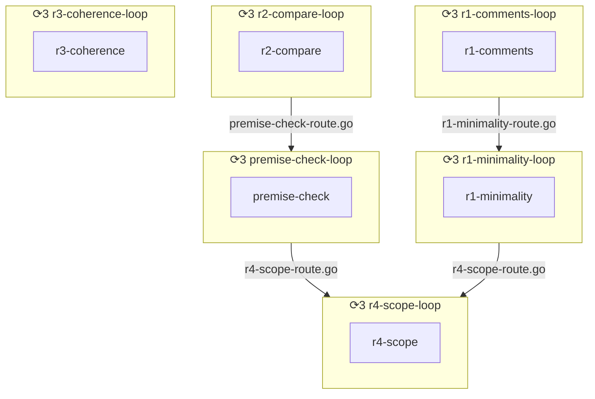

| 節 | 種類 | 何をする | 機械が貼る節 | 受け取る物 |
| --- | --- | --- | --- | --- |
| r1-comments-loop | ⟳3 | 設計に無い | - | - |
| r1-comments | AI | 独立の目: 変更が足したコメントを読み、消す候補を返す（読むだけ） | 2 | - |
| r1-minimality-loop | ⟳3 | 設計に無い | - | - |
| r1-minimality | AI | 独立の目: 変更の冗長さと最小性を読み、削れる所を返す（読むだけ） | 5 | - |
| r2-compare-loop | ⟳3 | 設計に無い | - | - |
| r2-compare | AI | 独立の目: 目的だけから作った独立設計と累積差分を突き合わせ、違いを返す（Read だけ） | 12 | - |
| premise-check-loop | ⟳3 | 設計に無い | - | - |
| premise-check | AI | 独立の目: 設計の前提が実物で崩れていないかを検算し、成り立つかを返す（読むだけ） | 2 | - |
| r3-coherence-loop | ⟳3 | 設計に無い | - | - |
| r3-coherence | AI | 独立の目: 変更の全体が整合しているかを読み、通すかを返す（読むだけ） | 5 | - |
| r4-scope-loop | ⟳3 | 設計に無い | - | - |
| r4-scope | AI | 独立の目: 変更が見落とした影響範囲を探し、表に出した物を返す（読むだけ） | 3 | - |

| 機械が貼る節 | 出どころ | 受ける役 | 入る条件 |
| --- | --- | --- | --- |
| {name}:1-{total} | fn:design.repo_map | r2-compare | design.repo_map |
| {name}（{src}） | fn:design.named_sections | r2-compare | design.named_sections |
| お前の役の定義（{agent}） | fn:rolekit.with_role_definition | premise-check・r1-comments・r1-minimality・r2-compare・r3-coherence・r4-scope | rolekit.with_role_definition |
| 人の関所の答え | fn:design.human_answers | r2-compare | design.human_answers |
| 依頼が名指した設計書の節 | fn:design.named_sections | r2-compare | design.named_sections |
| 前の回の受け付けが拒んだ理由 | fn:rolekit.with_reject | premise-check・r1-comments・r1-minimality・r2-compare・r3-coherence・r4-scope | rolekit.with_reject |
| 前提のずれ（修正の中の申告） | fn:eyes.premise_section | r2-compare | eyes.premise_section |
| 対象のリポジトリの地図 | fn:design.repo_map | r2-compare | design.repo_map |
| 最小の意味（works が足した読み替え。下の指示書の「累積差分が最小か」と観点の正本の「処方の最小性」の大きさは、この意味で読め） | fn:structmark.after_counts | r1-minimality | eyes.prep |
| 独立設計の後に来た人の答え（独立設計は見ていない） | fn:eyes.premise_section | r2-compare | eyes.premise_section |
| 独立設計を作った後に分かった前提（機械が貼った） | fn:eyes.premise_section | r2-compare | eyes.premise_section |
| 直す前の関所で人が通した狭まり（機械が貼った） | fn:gatemarks.carried_section | r4-scope | gatemarks.carried_section |
| 累積差分の渡し方（機械が貼った） | fn:eyes.diff_section | r2-compare | eyes.diff_section |
| 考えの住処の地図 | fn:concepthome.section | r1-minimality・r3-coherence | concepthome.section |
| 考えの住処の地図（機械が追跡されたファイルから探した。先に Read で読め） | fn:concepthome.section | r1-minimality・r3-coherence | concepthome.section |
| 考えの住処（works が足した観点） | fn:structmark.after_counts | r3-coherence | eyes.prep |
| 記録の制約 | fn:eyes.premise_section | r2-compare | eyes.premise_section |

## ブロック blk-fix

呼ぶ節: fixing・refitting

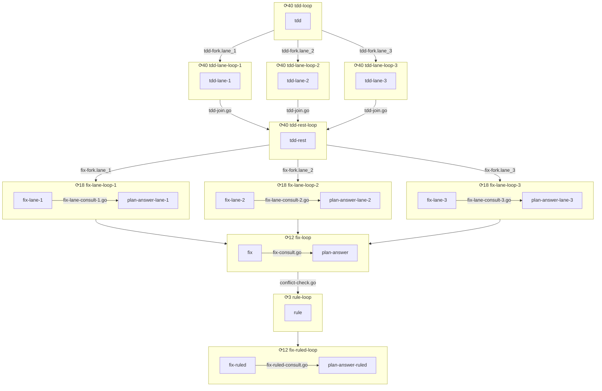

| 節 | 種類 | 何をする | 機械が貼る節 | 受け取る物 |
| --- | --- | --- | --- | --- |
| tdd-loop | ⟳40 | TDD の輪: 単位ごとにテスト→赤→直し→緑→整え（実行器の在る run だけ） | - | - |
| tdd | AI | TDD の役（今の単位を直す） | 30 | - |
| tdd-lane-loop-1 | ⟳40 | 枝 1 の TDD の輪（枝の worktree で、枝の単位を順に） | - | - |
| tdd-lane-1 | AI | 枝 1 の TDD の役（cwd は枝の worktree） | 36 | - |
| tdd-lane-loop-2 | ⟳40 | 枝 2 の TDD の輪（枝の worktree で、枝の単位を順に） | - | - |
| tdd-lane-2 | AI | 枝 2 の TDD の役（cwd は枝の worktree） | 36 | - |
| tdd-lane-loop-3 | ⟳40 | 枝 3 の TDD の輪（枝の worktree で、枝の単位を順に） | - | - |
| tdd-lane-3 | AI | 枝 3 の TDD の役（cwd は枝の worktree） | 36 | - |
| tdd-rest-loop | ⟳40 | 並べで済まなかった単位を順に回す TDD の輪 | - | - |
| tdd-rest | AI | 残りの単位の TDD の役 | 30 | - |
| fix-lane-loop-1 | ⟳18 | 枝 1 の修正役の輪（項目を順に・範囲の相談つき） | - | - |
| fix-lane-1 | AI | 枝 1 の修正役 | 35 | - |
| plan-answer-lane-1 | AI | 枝 1 の範囲の相談に答える（修正案の会話の写し） | 4 | - |
| fix-lane-loop-2 | ⟳18 | 枝 2 の修正役の輪（項目を順に・範囲の相談つき） | - | - |
| fix-lane-2 | AI | 枝 2 の修正役 | 35 | - |
| plan-answer-lane-2 | AI | 枝 2 の範囲の相談に答える（修正案の会話の写し） | 4 | - |
| fix-lane-loop-3 | ⟳18 | 枝 3 の修正役の輪（項目を順に・範囲の相談つき） | - | - |
| fix-lane-3 | AI | 枝 3 の修正役 | 35 | - |
| plan-answer-lane-3 | AI | 枝 3 の範囲の相談に答える（修正案の会話の写し） | 4 | - |
| fix-loop | ⟳12 | 修正役の輪（受け付けに通るまで出し直す） | - | - |
| fix | AI | 修正役: TDD の輪と枝で直していない単位を直す | 45 | - |
| plan-answer | AI | 範囲の相談に答える（修正案を書いた会話の続き。読むだけ） | 4 | - |
| rule-loop | ⟳3 | 裁定の輪 | - | - |
| rule | AI | 裁定役: 食い違いを持ち主の決まりで裁く（読むだけ） | 設計に無い | - |
| fix-ruled-loop | ⟳12 | 裁定の後の 2 回目の修正の輪 | - | - |
| fix-ruled | AI | 裁定の文を読んで直す（修正役の会話の続き） | 44 | - |
| plan-answer-ruled | AI | 範囲の相談に答える（修正案を書いた会話の続き。読むだけ） | 4 | - |

| 機械が貼る節 | 出どころ | 受ける役 | 入る条件 |
| --- | --- | --- | --- |
| 1 回目の修正の段で受け付けた返答（機械が貼った） | fn:fixrules.held_text | fix-ruled | fixrules.held_text |
| TDD の輪の並べの 1 単位（枝 {n} の {j} 番目・単位 {k}） | fn:tddlanes.lane_prep | tdd-lane-1・tdd-lane-2・tdd-lane-3 | tddlanes.lane_prep |
| TDD の輪の並べの回ごとの指示書（枝 {n} の {j} 番目の単位・{count} 回目・段 {phase}） | fn:tddlanes._next_text | tdd-lane-1・tdd-lane-2・tdd-lane-3 | tddlanes._next_text |
| TDD の輪の指示書（{count} 回目・段 {phase}） | fn:tddloop.prep | tdd・tdd-rest | tddloop.prep |
| TDD の輪の結果（機械が書いた） | fn:tddloop._finish | fix・fix-ruled | tddloop._finish |
| direct の単位（ここで直せ） | fn:tddloop._finish | fix・fix-ruled | tddloop._finish |
| works の決まり（下請け。上の型の文にも、読み替え unattended.md にも勝つ） | fn:seat.g1_prompt | fix・fix-ruled | seat.g1_prompt |
| {head}（確かめ {cid}・{count} 件） | fn:fixlanes.render_rejects | fix-lane-1・fix-lane-2・fix-lane-3 | fixlanes.render_rejects |
| {head}（確かめ {cid}・{count} 件） | fn:fixlanes.render_rejects | fix・fix-ruled | fixrules.last_reject |
| {id}: {unit_key} | fn:conflict.write_rulings | fix-ruled | conflict.write_rulings |
| {key} | fn:planbrief._unit | fix・fix-lane-1・fix-lane-2・fix-lane-3・fix-ruled・tdd・tdd-lane-1・tdd-lane-2・tdd-lane-3・tdd-rest | planbrief._unit |
| {lib} {version} | fn:libdocs._render | fix・fix-lane-1・fix-lane-2・fix-lane-3・fix-ruled | libdocs._render |
| {lib} {version}（手元の版。import せずに読んだ署名と説明） | fn:libdocs._local_text | fix・fix-lane-1・fix-lane-2・fix-lane-3・fix-ruled | libdocs._local_text |
| {title} | fn:libdocs._local_text | fix・fix-lane-1・fix-lane-2・fix-lane-3・fix-ruled | libdocs._local_text |
| この単位の決まり（機械が書いた） | fn:tddlanes.unit_text | tdd-lane-1・tdd-lane-2・tdd-lane-3 | tddlanes.unit_text |
| この段ですること | fn:tddlanes._next_text | tdd-lane-1・tdd-lane-2・tdd-lane-3 | tddlanes._next_text |
| この段ですること | fn:tddloop.prep | tdd・tdd-rest | tddloop.prep |
| やり方（approach） | fn:planbrief.render | fix・fix-lane-1・fix-lane-2・fix-lane-3・fix-ruled・tdd・tdd-lane-1・tdd-lane-2・tdd-lane-3・tdd-rest | planbrief.render |
| テストの回し方 | fn:tddlanes.unit_text | tdd-lane-1・tdd-lane-2・tdd-lane-3 | tddlanes.unit_text |
| テストの回し方 | fn:tddloop.prep | tdd・tdd-rest | tddloop.prep |
| ライブラリの文書（手元の版・公式） | fn:libdocs.section | fix・fix-lane-1・fix-lane-2・fix-lane-3・fix-ruled | libdocs.section |
| 下請けの型（superpowers の {file}。works の節で包んだ物） | fn:seat.section | fix・fix-lane-1・fix-lane-2・fix-lane-3・fix-ruled | seat.section |
| 下請けを回す | fn:seat.g1_section | fix・fix-ruled | seat.g1_section |
| 人の一言（関所 replan-gate） | fn:replan._notes | fix・fix-ruled | replan._notes |
| 今の単位 | fn:tddloop.prep | tdd・tdd-rest | tddloop.prep |
| 今の単位と一緒に直す単位（同じ修正案の項目。1 つの brief と 1 つのやり方を共にする） | fn:tddloop._together_lines | tdd・tdd-lane-1・tdd-lane-2・tdd-lane-3・tdd-rest | tddloop._together_lines |
| 今の単位と段 | fn:tddlanes._next_text | tdd-lane-1・tdd-lane-2・tdd-lane-3 | tddlanes._next_text |
| 修正の前の関所（policy-gate）で人が答えた条件（1 回目の修正の段と同じく、この段にも効く） | fn:replan._notes | fix・fix-ruled | replan._notes |
| 修正役の並べの枝 {n} の {j} 番目の項目（修正案の項目 {item}・この項目の {tries} 回目） | fn:fixlanes._next_text | fix-lane-1・fix-lane-2・fix-lane-3 | fixlanes._next_text |
| 修正役の並べの枝 {n} の {j} 番目の項目（修正案の項目 {item}） | fn:fixlanes._item | fix-lane-1・fix-lane-2・fix-lane-3 | fixlanes._item |
| 修正役の並べの枝の結末（機械が書いた。締めの節 fix-join） | fn:fixlanes.summary_text | fix・fix-ruled | fixlanes.summary_text |
| 修正役の並べの枝の結末（機械が書いた） | fn:fixrules.lanes_text | fix | fixrules.lanes_text |
| 借りたスキルの座 | fn:seat.section | fix・fix-lane-1・fix-lane-2・fix-lane-3・fix-ruled・tdd・tdd-lane-1・tdd-lane-2・tdd-lane-3・tdd-rest | seat.section |
| 前の単位の引き継ぎ（機械が状態から書いた物） | fn:tddloop.handoff_lines | tdd・tdd-lane-1・tdd-lane-2・tdd-lane-3・tdd-rest | tddloop.handoff_lines |
| 前の回の返答 | fn:conflict.write_rulings | fix-ruled | conflict.write_rulings |
| 前の回の返答を機械が拒んだ理由（直して、この段の返答を丸ごと出し直せ） | fn:fixrules.tdd_render | tdd・tdd-rest | fixrules.tdd_render |
| 前の回の返答を機械が拒んだ理由（直して、この段の返答を丸ごと出し直せ） | fn:tddlanes._next_text | tdd-lane-1・tdd-lane-2・tdd-lane-3 | tddlanes._next_text |
| 前の回の返答を機械が拒んだ理由（直して、返答を丸ごと出し直せ） | fn:fixlanes._next_text | fix-lane-1・fix-lane-2・fix-lane-3 | fixlanes._next_text |
| 受け入れのテスト（tests） | fn:planbrief.render | fix・fix-lane-1・fix-lane-2・fix-lane-3・fix-ruled・tdd・tdd-lane-1・tdd-lane-2・tdd-lane-3・tdd-rest | planbrief.render |
| 工程の地図 | fn:graphmap.render | plan-answer・plan-answer-lane-1・plan-answer-lane-2・plan-answer-lane-3・plan-answer-ruled | graphmap.render |
| 当てた項目（直しは run の作業ツリーに在る。changes に枝の返答の行を写す） | fn:fixlanes.summary_text | fix・fix-ruled | fixlanes.summary_text |
| 整えの申告（refactor） | fn:planbrief.render | fix・fix-lane-1・fix-lane-2・fix-lane-3・fix-ruled・tdd・tdd-lane-1・tdd-lane-2・tdd-lane-3・tdd-rest | planbrief.render |
| 書いてよいパス（allowed_paths） | fn:planbrief.render | fix・fix-lane-1・fix-lane-2・fix-lane-3・fix-ruled・tdd・tdd-lane-1・tdd-lane-2・tdd-lane-3・tdd-rest | planbrief.render |
| 書き換えてよい既存のテスト（rewrite_tests） | fn:planbrief.render | fix・fix-lane-1・fix-lane-2・fix-lane-3・fix-ruled・tdd・tdd-lane-1・tdd-lane-2・tdd-lane-3・tdd-rest | planbrief.render |
| 構造の目の行 | fn:planbrief.render | fix・fix-lane-1・fix-lane-2・fix-lane-3・fix-ruled・tdd・tdd-lane-1・tdd-lane-2・tdd-lane-3・tdd-rest | planbrief.render |
| 構造の目の行と処方への答え（structure） | fn:planbrief.render | fix・fix-lane-1・fix-lane-2・fix-lane-3・fix-ruled・tdd・tdd-lane-1・tdd-lane-2・tdd-lane-3・tdd-rest | planbrief.render |
| 構造の目の行（設計を知らない次の人が足す形が増えないかを別の目が見た判定。機械が貼った） | fn:structmark.plan_section | fix・fix-lane-1・fix-lane-2・fix-lane-3・fix-ruled・tdd・tdd-lane-1・tdd-lane-2・tdd-lane-3・tdd-rest | structmark.plan_section |
| 段 {phase} | fn:tddlanes.unit_text | tdd-lane-1・tdd-lane-2・tdd-lane-3 | tddlanes.unit_text |
| 段ごとの仕事と返す JSON | fn:tddlanes.unit_text | tdd-lane-1・tdd-lane-2・tdd-lane-3 | tddlanes.unit_text |
| 段の進め方 | fn:tddlanes.unit_text | tdd-lane-1・tdd-lane-2・tdd-lane-3 | tddlanes.unit_text |
| 消す物（removes） | fn:planbrief.render | fix・fix-lane-1・fix-lane-2・fix-lane-3・fix-ruled・tdd・tdd-lane-1・tdd-lane-2・tdd-lane-3・tdd-rest | planbrief.render |
| 狭める能力（narrows） | fn:planbrief.render | fix・fix-lane-1・fix-lane-2・fix-lane-3・fix-ruled・tdd・tdd-lane-1・tdd-lane-2・tdd-lane-3・tdd-rest | planbrief.render |
| 目的の文（凍結） | fn:planbrief.render | fix・fix-lane-1・fix-lane-2・fix-lane-3・fix-ruled・tdd・tdd-lane-1・tdd-lane-2・tdd-lane-3・tdd-rest | planbrief.render |
| 直した項目 {item}（単位 {units}）の事前審査の穴 | fn:replan._notes | fix・fix-ruled | replan._notes |
| 直し方の道（route） | fn:planbrief.render | fix・fix-lane-1・fix-lane-2・fix-lane-3・fix-ruled・tdd・tdd-lane-1・tdd-lane-2・tdd-lane-3・tdd-rest | planbrief.render |
| 直す単位 | fn:planbrief.render | fix・fix-lane-1・fix-lane-2・fix-lane-3・fix-ruled・tdd・tdd-lane-1・tdd-lane-2・tdd-lane-3・tdd-rest | planbrief.render |
| 直す義務から外れた単位（直すな。not_done に理由を書け） | fn:tddloop._finish | fix・fix-ruled | tddloop._finish |
| 直す義務の単位 | fn:tddloop.prep | tdd・tdd-rest | tddloop.prep |
| 相談 {n}: 項目 {item}（単位: {units}） | fn:consult.question | plan-answer・plan-answer-lane-1・plan-answer-lane-2・plan-answer-lane-3・plan-answer-ruled | consult.gate_asks |
| 相談 {n}: 項目 {item}（単位: {units}） | fn:consult.question | plan-answer・plan-answer-lane-1・plan-answer-lane-2・plan-answer-lane-3・plan-answer-ruled | consult.question |
| 相談（項目 {item}・パス {paths}・テスト {tests}{new_tests}） | fn:consult.answer_text | fix・fix-lane-1・fix-lane-2・fix-lane-3 | consult.answer_text |
| 範囲の相談の答え（相談の周 {turn}） | fn:consult.answer_text | fix・fix-lane-1・fix-lane-2・fix-lane-3 | consult.answer_text |
| 範囲の相談（修正の段から） | fn:consult.question | plan-answer・plan-answer-lane-1・plan-answer-lane-2・plan-answer-lane-3・plan-answer-ruled | consult.question |
| 背景（参照。brief と食い違えば brief が勝つ。brief が誤りと見たら申し出よ） | fn:planbrief.render | fix・fix-lane-1・fix-lane-2・fix-lane-3・fix-ruled・tdd・tdd-lane-1・tdd-lane-2・tdd-lane-3・tdd-rest | planbrief.render |
| 要求の正本: 修正案の項目 {n} | fn:planbrief.render | fix・fix-lane-1・fix-lane-2・fix-lane-3・fix-ruled・tdd・tdd-lane-1・tdd-lane-2・tdd-lane-3・tdd-rest | planbrief.render |
| 要求の正本（brief） | fn:planbrief.head_text | fix・fix-lane-1・fix-lane-2・fix-lane-3・fix-ruled・tdd・tdd-lane-1・tdd-lane-2・tdd-lane-3・tdd-rest | planbrief.head_text |
| 触らない物（out_of_scope） | fn:planbrief.render | fix・fix-lane-1・fix-lane-2・fix-lane-3・fix-ruled・tdd・tdd-lane-1・tdd-lane-2・tdd-lane-3・tdd-rest | planbrief.render |
| 読む物 | fn:fixlanes._next_text | fix-lane-1・fix-lane-2・fix-lane-3 | fixlanes._next_text |
| 読む物 | fn:tddlanes._next_text | tdd-lane-1・tdd-lane-2・tdd-lane-3 | tddlanes._next_text |
| 足さずに閉じる形（shrink_first） | fn:planbrief.render | fix・fix-lane-1・fix-lane-2・fix-lane-3・fix-ruled・tdd・tdd-lane-1・tdd-lane-2・tdd-lane-3・tdd-rest | planbrief.render |
| 足す物（adds） | fn:planbrief.render | fix・fix-lane-1・fix-lane-2・fix-lane-3・fix-ruled・tdd・tdd-lane-1・tdd-lane-2・tdd-lane-3・tdd-rest | planbrief.render |
| 輪で直した単位（直さず、changes に 1 行を書け。テストのファイルは変えるな——受け付けが拒む。食い違いの裁定 fix_test_scope が範囲に並べた所だけは例外。修正案の rewrite_tests の名指しは輪で書き換えて凍結した） | fn:tddloop._finish | fix・fix-ruled | tddloop._finish |
| 返す JSON | fn:tddlanes._next_text | tdd-lane-1・tdd-lane-2・tdd-lane-3 | tddlanes._next_text |
| 返す JSON | fn:tddloop.prep | tdd・tdd-rest | tddloop.prep |
| 順に戻した項目（この周で直す。下請けの項目に載る） | fn:fixlanes.summary_text | fix・fix-ruled | fixlanes.summary_text |
| 食い違いで止めた単位（直すな。輪の後に裁定役が裁き、裁定が理由のファイルで届く） | fn:tddloop._finish | fix・fix-ruled | tddloop._finish |
| 食い違いの申し出の裁定（機械が書いた。裁いたのは読むだけの裁定役か機械） | fn:conflict.write_rulings | fix-ruled | conflict.write_rulings |
| 食い違いの申し出（どの段でも） | fn:tddlanes.unit_text | tdd-lane-1・tdd-lane-2・tdd-lane-3 | tddlanes.unit_text |

## ブロック blk-judge

呼ぶ節: judging

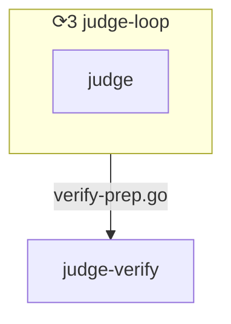

| 節 | 種類 | 何をする | 機械が貼る節 | 受け取る物 |
| --- | --- | --- | --- | --- |
| judge-loop | ⟳3 | 設計に無い | - | - |
| judge | AI | 判定役: 人の修正依頼を読み、根本の単位にまとめてラベルと処置を返す（読むだけ） | 11 | - |
| judge-verify | AI | 裏取りの束ね役: 判定の単位ごとに確かめる下請けを並べて起こし、要約を返す | 7 | - |

| 機械が貼る節 | 出どころ | 受ける役 | 入る条件 |
| --- | --- | --- | --- |
| PR #{number} | fn:entryshape.write_pr_file | judge | entryshape.write_pr_file |
| PR #{number} の題と本文 | fn:entryshape.request_text | judge | entryshape.request_text |
| お前の単位: 単位 {n} | fn:judgeverify.prep_on | judge-verify | judgeverify.prep_on |
| お前の確かめ: 単位どうしの相乗り | fn:judgeverify.prep_on | judge-verify | judgeverify.prep_on |
| 世界の解の行（依頼の行ごとの問題の類・世の中の定石・依頼の解き方との比べ） | fn:worldmark.section | judge | worldmark.section |
| 依頼 | fn:entryshape.request_text | judge | entryshape.request_text |
| 依頼の answers（全部。依頼者が前の run の問いに答えた物。字が問いの key か出どころに当たらない答えは、返答の answer_ties で問いか単位に結ぶ） | fn:judgebrief.answers_section | judge | judgebrief.answers_section |
| 判定の単位の裏取りの下請け | fn:judgeverify._head | judge-verify | judgeverify._head |
| 判定の単位の裏取りの束ね役（機械が書いた） | fn:judgeverify.prep_on | judge-verify | judgeverify.prep_on |
| 判定の材料（盤面から描いた物） | fn:judgebrief.brief | judge | judgebrief.brief |
| 判定者の見立て | fn:judgeverify._head | judge-verify | judgeverify._head |
| 前の run で最後まで通らなかった物（機械が貼った。受け付けの拒否の行は直す穴ではない——同じ所で落ちない返答を出すための注意） | fn:carry.prior_section | judge | carry.prior_section |
| 前の周の独立の目が作り直しを要ると言った物——直す穴。この周の先頭で直す | fn:carry.prior_section | judge | carry.prior_section |
| 単位の全部 | fn:judgeverify.prep_on | judge-verify | judgeverify.prep_on |
| 問いの台帳（本線の判定の指示書の同じ段。kind・status・書ける欄はここが正本） | fn:judgebrief.template | judge | judgebrief.template |
| 本文 | fn:entryshape.write_pr_file | judge | entryshape.write_pr_file |
| 決まり（全部の下請けで同じ） | fn:judgeverify._head | judge-verify | judgeverify._head |
| 題 | fn:entryshape.write_pr_file | judge | entryshape.write_pr_file |

## ブロック blk-lens

呼ぶ節: lensing

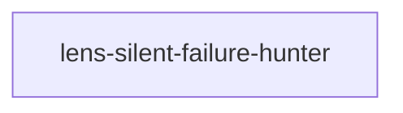

| 節 | 種類 | 何をする | 機械が貼る節 | 受け取る物 |
| --- | --- | --- | --- | --- |
| lens-silent-failure-hunter | AI | 黙った失敗のレンズ: 変更が失敗を握りつぶしていないかを読み、指摘を返す（読むだけ） | 3 | - |

| 機械が貼る節 | 出どころ | 受ける役 | 入る条件 |
| --- | --- | --- | --- |
| お前の役の定義（{agent}） | fn:rolekit.with_role_definition | lens-silent-failure-hunter | lenses.render |
| この節での仕事 | fn:lenses.render | lens-silent-failure-hunter | lenses.render |
| 返答の書き方 | fn:lenses.render | lens-silent-failure-hunter | lenses.render |

## ブロック blk-material

呼ぶ節: gathering

```mermaid
flowchart TD
  subgraph L_prior_decisions_loop["⟳3 prior-decisions-loop"]
    N_prior_decisions["prior-decisions"]
  end
  subgraph L_purpose_review_loop["⟳3 purpose-review-loop"]
    N_purpose_review["purpose-review"]
  end
  subgraph L_local_review_loop["⟳3 local-review-loop"]
    N_local_review["local-review"]
  end
  subgraph L_consistency_bypass_loop["⟳3 consistency-bypass-loop"]
    N_consistency_bypass["consistency-bypass"]
  end
  subgraph L_hygiene_loop["⟳3 hygiene-loop"]
    N_hygiene["hygiene"]
  end
  subgraph L_external_standards_loop["⟳3 external-standards-loop"]
    N_external_standards["external-standards"]
  end
  subgraph L_procedure_trace_loop["⟳3 procedure-trace-loop"]
    N_procedure_trace["procedure-trace"]
  end
  subgraph L_gate_efficacy_loop["⟳3 gate-efficacy-loop"]
    N_gate_efficacy["gate-efficacy"]
  end
  subgraph L_test_double_fidelity_loop["⟳3 test-double-fidelity-loop"]
    N_test_double_fidelity["test-double-fidelity"]
  end
  subgraph L_main_path_observation_loop["⟳3 main-path-observation-loop"]
    N_main_path_observation["main-path-observation"]
  end
  subgraph L_provenance_loop["⟳3 provenance-loop"]
    N_provenance["provenance"]
  end
```

| 節 | 種類 | 何をする | 機械が貼る節 | 受け取る物 |
| --- | --- | --- | --- | --- |
| prior-decisions-loop | ⟳3 | 設計に無い | - | - |
| prior-decisions | AI | 先行議論の突合: 過去の議論・決定を探し、今回の変更と食い違う所を返す | 5 | - |
| purpose-review-loop | ⟳3 | 設計に無い | - | - |
| purpose-review | AI | 目的の審査: 変更が目的に沿っているかを読み、外れた所を返す（読むだけ） | 5 | - |
| local-review-loop | ⟳3 | 設計に無い | - | - |
| local-review | AI | 局所レビュー: レビューのスキルと agent のレンズを起こし、指摘を集めて返す | 5 | - |
| consistency-bypass-loop | ⟳3 | 設計に無い | - | - |
| consistency-bypass | AI | 整合性と迂回の目: 既存の仕組みを避けた作りが無いかを読み、指摘を返す（読むだけ） | 5 | - |
| hygiene-loop | ⟳3 | 設計に無い | - | - |
| hygiene | AI | 文脈を持たない読み手: 渡された差分と観点だけを読み、指摘を返す（道具なし） | 5 | - |
| external-standards-loop | ⟳3 | 設計に無い | - | - |
| external-standards | AI | 外部標準照合: 作る前に既製の定番解が無いかを調べ、比べた結果を返す | 5 | - |
| procedure-trace-loop | ⟳3 | 設計に無い | - | - |
| procedure-trace | AI | 手順トレース: 変更に関わる手順を順にたどって確かめ、指摘を返す | 5 | - |
| gate-efficacy-loop | ⟳3 | 設計に無い | - | - |
| gate-efficacy | AI | ゲートの実効性確認: 検査が落とすべき物を本当に落とすかを写しの上で確かめて返す | 5 | - |
| test-double-fidelity-loop | ⟳3 | 設計に無い | - | - |
| test-double-fidelity | AI | 代役の忠実性: テストの代役が本物と同じ振る舞いかを確かめ、食い違いを返す | 5 | - |
| main-path-observation-loop | ⟳3 | 設計に無い | - | - |
| main-path-observation | AI | 主経路の実行観測: 変更した主経路を写しの上で走らせ、観測した事を返す | 5 | - |
| provenance-loop | ⟳3 | 設計に無い | - | - |
| provenance | AI | 根拠の出所検査: 変更が頼る根拠の出所を確かめ、主張ごとの結果を返す | 5 | - |

| 機械が貼る節 | 出どころ | 受ける役 | 入る条件 |
| --- | --- | --- | --- |
| /code-review の返り方（works の受け付けより。上の指示書の読み替え） | fn:material.prep | consistency-bypass・external-standards・gate-efficacy・hygiene・local-review・main-path-observation・prior-decisions・procedure-trace・provenance・purpose-review・test-double-fidelity | material.prep |
| 『条件に当たらない』（not_applicable）を書けるか（works の受け付けより。上の指示書の読み替え） | fn:material._na_note | consistency-bypass・external-standards・gate-efficacy・hygiene・local-review・main-path-observation・prior-decisions・procedure-trace・provenance・purpose-review・test-double-fidelity | material._na_note |
| 前の回の受け付けが拒んだ理由 | fn:material.prep | consistency-bypass・external-standards・gate-efficacy・hygiene・local-review・main-path-observation・prior-decisions・procedure-trace・provenance・purpose-review・test-double-fidelity | material.prep |
| 必須のレンズの呼び出しの失敗（works の受け付けより。上の指示書の読み替え） | fn:material.prep | consistency-bypass・external-standards・gate-efficacy・hygiene・local-review・main-path-observation・prior-decisions・procedure-trace・provenance・purpose-review・test-double-fidelity | material.prep |
| 所見の場所の書き方（works の受け付けより） | fn:material.prep | consistency-bypass・external-standards・gate-efficacy・hygiene・local-review・main-path-observation・prior-decisions・procedure-trace・provenance・purpose-review・test-double-fidelity | material.prep |

## ブロック blk-plan

呼ぶ節: planning・replanning

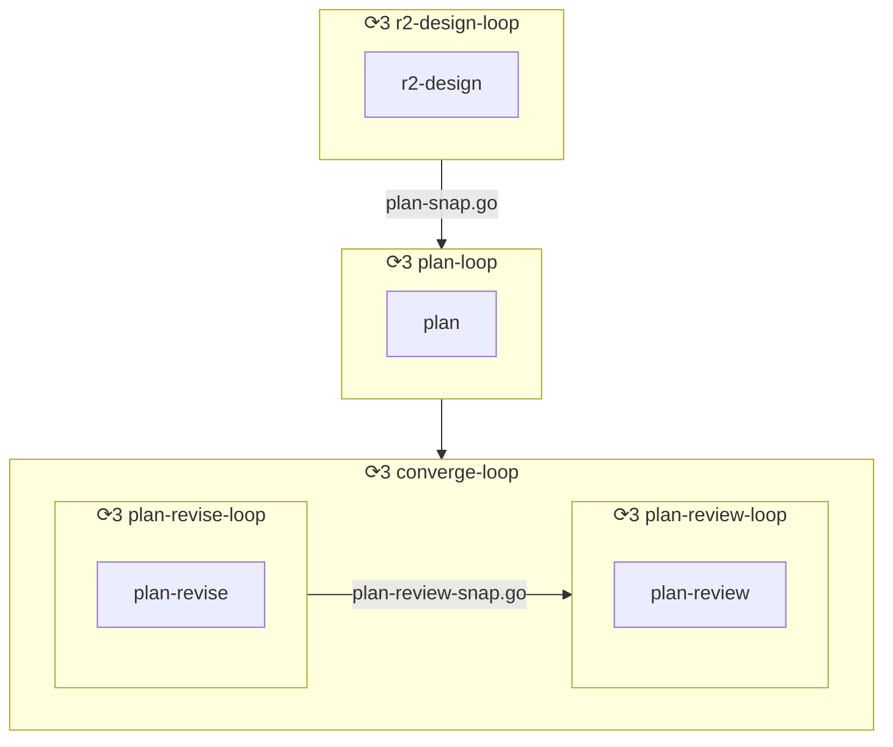

| 節 | 種類 | 何をする | 機械が貼る節 | 受け取る物 |
| --- | --- | --- | --- | --- |
| r2-design-loop | ⟳3 | 独立設計の輪（目的と制約だけから理想解を作る。修正案を見ない） | - | - |
| r2-design | AI | 独立設計の役（道具ゼロ） | 8 | - |
| plan-loop | ⟳3 | 修正案の輪（受け付けに通るまで出し直す） | - | - |
| plan | AI | 修正案の役: 判定の単位を直す項目（書いてよい範囲・テスト）に分ける | 22 | - |
| converge-loop | ⟳3 | 壁打ち: 事前審査が block を挙げたら案を直し、審査し直す | - | - |
| plan-revise-loop | ⟳3 | 案の直しの輪 | - | - |
| plan-revise | AI | block に答えて案を直す（修正案の会話の続き） | 14 | - |
| plan-review-loop | ⟳3 | 事前審査の輪 | - | - |
| plan-review | AI | 事前審査の役（review_tree が on か、auto で開いた項目が 2 つ以上なら項目ごとの下請けと相乗りの審査） | 35 | - |

| 機械が貼る節 | 出どころ | 受ける役 | 入る条件 |
| --- | --- | --- | --- |
| {key} | fn:converge._face_text | plan・plan-review・plan-revise | converge._face_text |
| {key} | fn:planblk.prescription_section | plan・plan-revise | planblk.prescription_section |
| {lib} {version} | fn:libdocs._render | plan・plan-review | libdocs._render |
| {lib} {version}（手元の版。import せずに読んだ署名と説明） | fn:libdocs._local_text | plan・plan-review | libdocs._local_text |
| {name}:1-{total} | fn:design.repo_map | r2-design | design.repo_map |
| {name}（{src}） | fn:design.named_sections | r2-design | design.named_sections |
| {n} 往復目の block | fn:converge.review_section | plan-review | converge.review_section |
| {title} | fn:libdocs._local_text | plan・plan-review | libdocs._local_text |
| お前の審査: 相乗りの審査 | fn:planblk.tree_part | plan-review | planblk.tree_part |
| お前の役の定義（{agent}） | fn:rolekit.with_role_definition | plan・plan-review・plan-revise・r2-design | rolekit.with_role_definition |
| お前の項目: 項目 {n} | fn:planblk.tree_part | plan-review | planblk.tree_part |
| この項目の先行例の出典（判定者の先行例のうち adopt・adapt。見ること 8） | fn:planblk._precedent_part | plan-review | planblk._precedent_part |
| この項目の前の往復の block（下は前の往復で挙がった block と、修正案の役の答え（fixed＝直した・disputed＝異を唱えた）。今の案を読み、前の block の key ごとに、穴が消えたなら resolved にその key を入れ、残っていれば同じ key のまま faces に severity block で挙げ直せ（同じ穴に別の key を付けない。key は一字も変えずに写す）。新しい穴は新しい key で挙げよ。前の block が 1 つでも block のまま残ると、案は直しへ進まず人の関所で止まる。） | fn:planblk._item_history | plan-review | planblk._item_history |
| ライブラリの文書（手元の版・公式） | fn:libdocs.section | plan・plan-review | libdocs.section |
| 世界の解の行（依頼の行ごとの問題の類・世の中の定石・依頼の解き方との比べ） | fn:worldmark.section | plan | worldmark.section |
| 事前審査の下請け | fn:planblk.brief_head | plan-review | planblk.brief_head |
| 人が決めた前提（機械が貼った） | fn:design.prep | r2-design | design.prep |
| 人の関所の答え | fn:design.human_answers | r2-design | design.human_answers |
| 依頼が名指した設計書の節 | fn:design.named_sections | r2-design | design.named_sections |
| 修正の段の申し出と裁定（{id}） | fn:replan._section | plan・plan-review | replan._section |
| 修正案の項目 {n} | fn:planmarks.review_section | plan-review | planmarks.review_section |
| 修正案の項目の works の欄（機械が貼った） | fn:planmarks.review_section | plan-review | planmarks.review_section |
| 判定の処方（判定役が単位ごとに書いた直し方の案。零処方から並ぶ。機械が判定の記録から貼った） | fn:planblk.prescription_section | plan・plan-revise | planblk.prescription_section |
| 判定の単位の裏取り（判定とは別の目が単位ごとに確かめた申し送り。機械が貼った） | fn:planblk.verify_part | plan・plan-revise | planblk.verify_part |
| 前の run で最後まで通らなかった物（機械が貼った。受け付けの拒否の行は直す穴ではない——同じ所で落ちない返答を出すための注意） | fn:carry.prior_section | plan・plan-revise | carry.prior_section |
| 前の周の独立の目が作り直しを要ると言った物——直す穴。この周の先頭で直す | fn:carry.prior_section | plan・plan-revise | carry.prior_section |
| 前の回の受け付けが拒んだ理由 | fn:rolekit.with_reject | plan・plan-review・plan-revise・r2-design | rolekit.with_reject |
| 前の往復からのこの項目の案の差分（見るのはこの差分と前の block の行き先だけ） | fn:planblk._diff_part | plan-review | planblk._diff_part |
| 前の往復で答えた当たり（機械が答えを引き継ぐ。hits に入れなくてよい。差分で答えが変わる物だけ入れ直せ） | fn:planblk._carried_part | plan-review | planblk._carried_part |
| 前の答えの誤り（機械の確かめ。この誤りだけを直して同じファイルに書き直せ） | fn:planblk._errors_part | plan-review | planblk._errors_part |
| 前の項目（承認済み。機械が貼った） | fn:replan._section | plan・plan-review | replan._section |
| 単位 {unit_key} | fn:ripple.units_section | plan・plan-revise | ripple.units_section |
| 対象のリポジトリの地図 | fn:design.repo_map | r2-design | design.repo_map |
| 工程の地図 | fn:graphmap.render | plan・plan-revise | graphmap.render |
| 束ね役の頼み（項目ごとの下請けを並べる。機械が貼った） | fn:planblk.tree_part | plan-review | planblk.tree_part |
| 案に入れてよい単位の no（機械が受け付けと同じ述語から作った。下の本文の『今の周に直す単位』の見出しと、one_shot_closes に載る単位より、この節が優先する） | fn:planblk.plan_slots_section | plan・plan-revise | planblk.plan_slots_section |
| 構造の目の行（設計を知らない次の人が足す形が増えないかを別の目が見た判定。機械が貼った） | fn:structmark.plan_section | plan・plan-revise | structmark.plan_section |
| 構造の目の避け方・判定の処方・世界の解から外れた訳（修正案の欄 structure から機械が並べた。訳が成り立つかを見よ） | fn:planmarks.review_section | plan-review | planmarks.review_section |
| 波及の一覧（機械が git grep で引いた。単位の key が名指す名の呼び出し元と試験。案を書く前に読め） | fn:ripple.units_section | plan・plan-revise | ripple.units_section |
| 波及の一覧（機械が git grep で引いた。項目が変える名の呼び出し元と試験） | fn:ripple.section | plan-review | ripple.section |
| 独立設計（修正案を見ない別の目が、目的と実測した制約・人の関所の答え・依頼が名指した設計書の節から作った理想解。機械が貼った） | fn:planblk.design_only | plan-review | planblk.design_only |
| 直した項目（修正案の役が返した形。機械が貼った） | fn:replan._section | plan-review | replan._section |
| 直す項目 {n}（承認済みの修正案の項目の番号） | fn:replan._section | plan・plan-review | replan._section |
| 答え方（全部の下請けで同じ） | fn:planblk.brief_head | plan-review | planblk.brief_head |
| 考えの住処の地図 | fn:concepthome.section | plan・plan-review・plan-revise | concepthome.section |
| 考えの住処の地図（機械が追跡されたファイルから探した。先に Read で読め） | fn:concepthome.section | plan・plan-review・plan-revise | concepthome.section |
| 項目 {n} | fn:ripple.item_text | plan-review | ripple.item_text |
| 項目 {n} の単位（判定） | fn:planblk.tree_part | plan-review | planblk.tree_part |
| 項目 {n} の案 | fn:planblk.tree_part | plan-review | planblk.tree_part |
| 項目 {n}（unit_keys: {keys}） | fn:ripple.item_text | plan-review | ripple.item_text |
| 項目どうしの重なり（機械が範囲と波及の一覧から引いた） | fn:planblk.tree_part | plan-review | planblk.tree_part |
| 項目の全部（閉じた項目も含む） | fn:planblk.tree_part | plan-review | planblk.tree_part |

## ブロック blk-pr

呼ぶ節: pr-checking

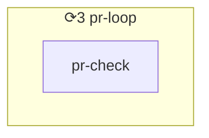

| 節 | 種類 | 何をする | 機械が貼る節 | 受け取る物 |
| --- | --- | --- | --- | --- |
| pr-loop | ⟳3 | 設計に無い | - | - |
| pr-check | AI | 並行 PR の衝突チェック: 開いている PR を読むだけで調べ、変更と衝突する物を返す | 設計に無い | - |

機械が貼る節: 設計に無い（受け手の表 RECEIVES に行が無い）

## ブロック blk-premises

呼ぶ節: premising

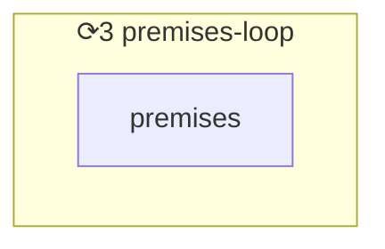

| 節 | 種類 | 何をする | 機械が貼る節 | 受け取る物 |
| --- | --- | --- | --- | --- |
| premises-loop | ⟳3 | 設計に無い | - | - |
| premises | AI | 実測役: 依頼の数値・件数・有無の主張を作業ツリーで測り直し、制約の一覧を返す | 設計に無い | - |

機械が貼る節: 設計に無い（受け手の表 RECEIVES に行が無い）

## ブロック blk-purpose

呼ぶ節: purposing

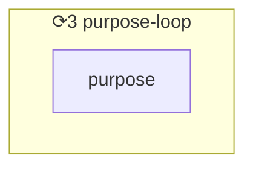

| 節 | 種類 | 何をする | 機械が貼る節 | 受け取る物 |
| --- | --- | --- | --- | --- |
| purpose-loop | ⟳3 | 設計に無い | - | - |
| purpose | AI | 目的の役: 依頼を読み、元の目的を 1 つの文にして返す（解き方は分けて並べる。読むだけ） | 設計に無い | - |

機械が貼る節: 設計に無い（受け手の表 RECEIVES に行が無い）

## ブロック blk-refix

呼ぶ節: refixing

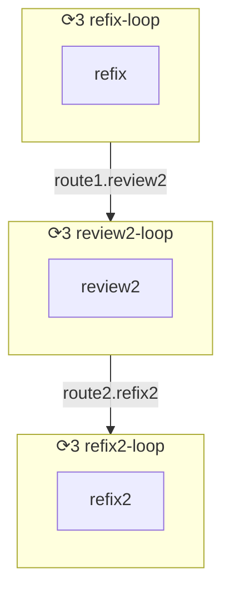

| 節 | 種類 | 何をする | 機械が貼る節 | 受け取る物 |
| --- | --- | --- | --- | --- |
| refix-loop | ⟳3 | 設計に無い | - | - |
| refix | AI | 手直し役: 差分の審査が挙げた穴を直し、穴ごとの扱いを返す（1 回目） | 1 | - |
| review2-loop | ⟳3 | 設計に無い | - | - |
| review2 | AI | 手直しの審査役: 手直しだけの差分を読み、手直しが新しく作った穴を返す（2 回目。読むだけ） | 設計に無い | - |
| refix2-loop | ⟳3 | 設計に無い | - | - |
| refix2 | AI | 手直し役: 2 回目の審査が挙げた穴を直し、穴ごとの扱いを返す（最後） | 1 | - |

| 機械が貼る節 | 出どころ | 受ける役 | 入る条件 |
| --- | --- | --- | --- |
| 借りたスキルの座 | fn:seat.section | refix・refix2 | seat.section |

## ブロック blk-rejudge

呼ぶ節: rejudging

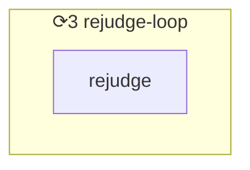

| 節 | 種類 | 何をする | 機械が貼る節 | 受け取る物 |
| --- | --- | --- | --- | --- |
| rejudge-loop | ⟳3 | 設計に無い | - | - |
| rejudge | AI | 判定役の続き: 修正役の異議を読み、自分の判定を同じ会話で考え直して返す（読むだけ） | 1 | - |

| 機械が貼る節 | 出どころ | 受ける役 | 入る条件 |
| --- | --- | --- | --- |
| 前の回の受け付けが拒んだ理由 | fn:rejudge.prep | rejudge | rejudge.prep |

## ブロック blk-report

呼ぶ節: reporting

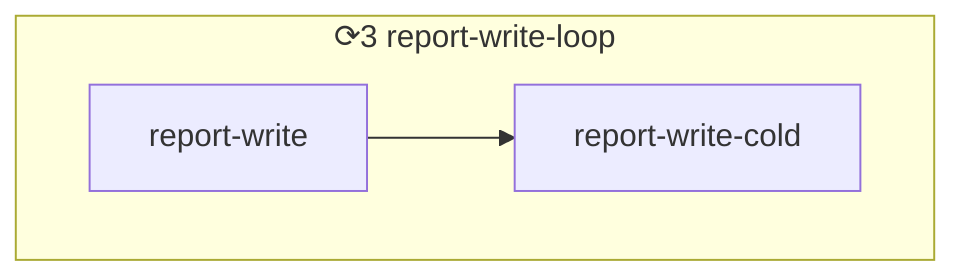

| 節 | 種類 | 何をする | 機械が貼る節 | 受け取る物 |
| --- | --- | --- | --- | --- |
| report-write-loop | ⟳3 | 設計に無い | - | - |
| report-write | AI | 報告の書き手: run の記録を読み、平易な冒頭・人が決めること・本文を書いて返す | 2 | - |
| report-write-cold | AI | 文脈を持たない初見の読み手: 報告の本文だけを読み、詰まった所と推測した所を返す | 設計に無い | - |

| 機械が貼る節 | 出どころ | 受ける役 | 入る条件 |
| --- | --- | --- | --- |
| --- | fn:report_roles.prep | report-write | report_roles.prep |
| 前の回の受け付けが拒んだ理由 | fn:report_roles.prep | report-write | report_roles.prep |

## ブロック blk-spec

呼ぶ節: speccing

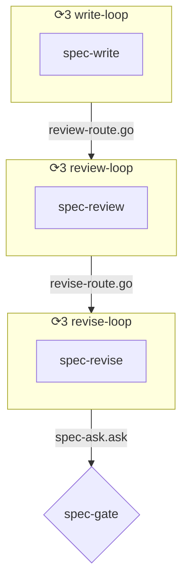

| 節 | 種類 | 何をする | 機械が貼る節 | 受け取る物 |
| --- | --- | --- | --- | --- |
| write-loop | ⟳3 | 設計に無い | - | - |
| spec-write | AI | 仕様の書き手: 依頼が完成と言える要件を書き、受け入れ条件をテストとして書いて返す | 1 | - |
| review-loop | ⟳3 | 設計に無い | - | - |
| spec-review | AI | 仕様の審査役: 要件と受け入れ条件の抜け・曖昧さ・範囲の外を挙げて返す（読むだけ） | 1 | - |
| revise-loop | ⟳3 | 設計に無い | - | - |
| spec-revise | AI | 仕様の書き手: 審査が挙げた穴に 1 度ずつ答え、直した仕様の全体を返す | 1 | - |
| spec-gate | 人の関所 | 設計に無い | - | - |

| 機械が貼る節 | 出どころ | 受ける役 | 入る条件 |
| --- | --- | --- | --- |
| 前の回の受け付けが拒んだ理由 | fn:specblk.prep | spec-review・spec-revise・spec-write | specblk.prep |

## ブロック blk-structure

呼ぶ節: measuring-after・structuring

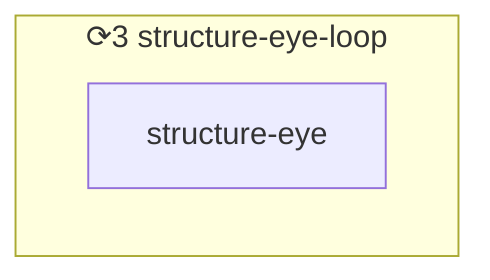

| 節 | 種類 | 何をする | 機械が貼る節 | 受け取る物 |
| --- | --- | --- | --- | --- |
| structure-eye-loop | ⟳3 | 設計に無い | - | - |
| structure-eye | AI | 構造の目: 直しの単位ごとに、直しがコードの構造を汚すかを判定して返す（道具なし） | 5 | - |

| 機械が貼る節 | 出どころ | 受ける役 | 入る条件 |
| --- | --- | --- | --- |
| 前の回の受け付けが拒んだ理由 | fn:eye.render | structure-eye | eye.render |
| 単位と実測（structure.json から機械が抜いた物。これが渡された物の全部） | fn:eye.render | structure-eye | eye.render |
| 問い | fn:eye.render | structure-eye | eye.render |
| 見る形（番号で答える） | fn:eye.render | structure-eye | eye.render |
| 返し方 | fn:eye.render | structure-eye | eye.render |

## ブロック blk-tests

呼ぶ節: testing

```mermaid
flowchart TD
```

| 節 | 種類 | 何をする | 機械が貼る節 | 受け取る物 |
| --- | --- | --- | --- | --- |

## ブロック blk-world

呼ぶ節: worlding

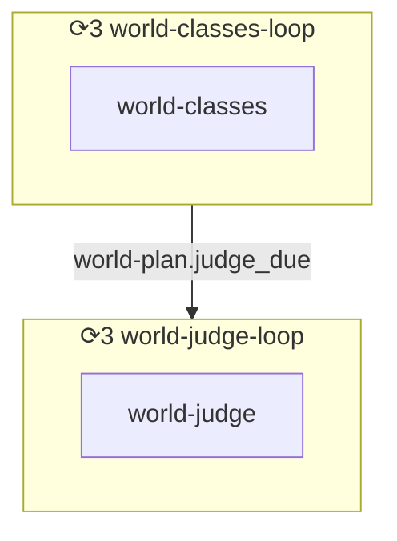

| 節 | 種類 | 何をする | 機械が貼る節 | 受け取る物 |
| --- | --- | --- | --- | --- |
| world-classes-loop | ⟳3 | 設計に無い | - | - |
| world-classes | AI | 言い直す役: 依頼の各行を解き方と対象の名を外した問題の類に言い直し、検索語を返す（道具なし） | 4 | - |
| world-judge-loop | ⟳3 | 設計に無い | - | - |
| world-judge | AI | web の役: 問題の類ごとに定石を web で集め、依頼の解き方が定石と同じか違うかを返す | 4 | - |

| 機械が貼る節 | 出どころ | 受ける役 | 入る条件 |
| --- | --- | --- | --- |
| 依頼の行（機械が依頼のファイルから抜いた物。これが渡された物の全部） | fn:worldblk.classes_prep | world-classes | worldblk.classes_prep |
| 前の回の受け付けが拒んだ理由 | fn:rolekit.with_reject | world-classes・world-judge | rolekit.with_reject |
| 問題の類と依頼の解き方（機械が言い直しの返答から抜いた物。これが渡された物の全部） | fn:worldblk.judge_prep | world-judge | worldblk.judge_prep |
| 目的の文 | fn:worldblk.classes_prep | world-classes | worldblk.classes_prep |
| 返し方 | fn:worldblk.classes_prep | world-classes | worldblk.classes_prep |
| 返し方 | fn:worldblk.classes_prep | world-judge | worldblk.judge_prep |
| 類 {class_id} | fn:worldblk.judge_prep | world-judge | worldblk.judge_prep |
